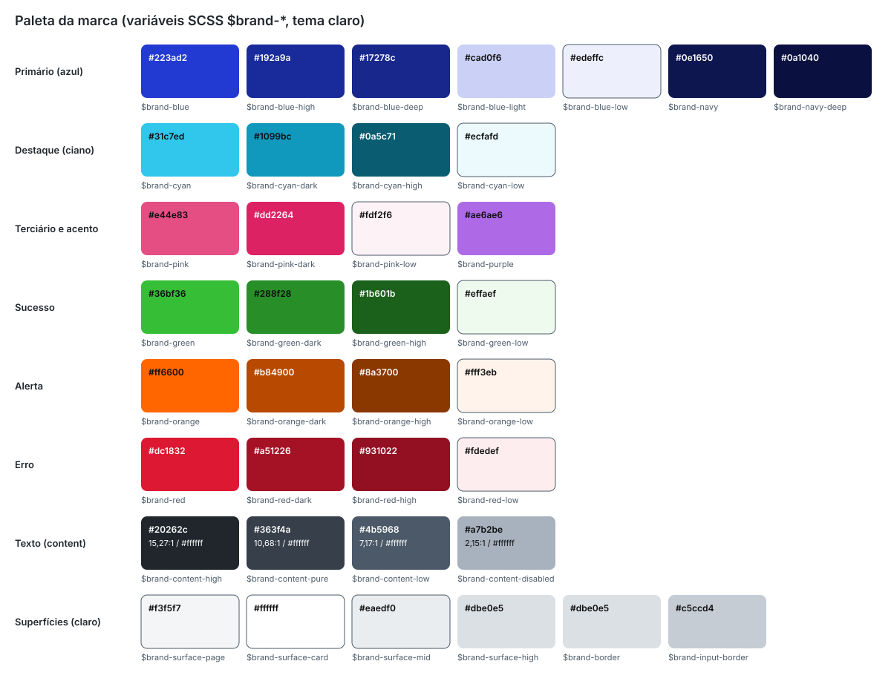
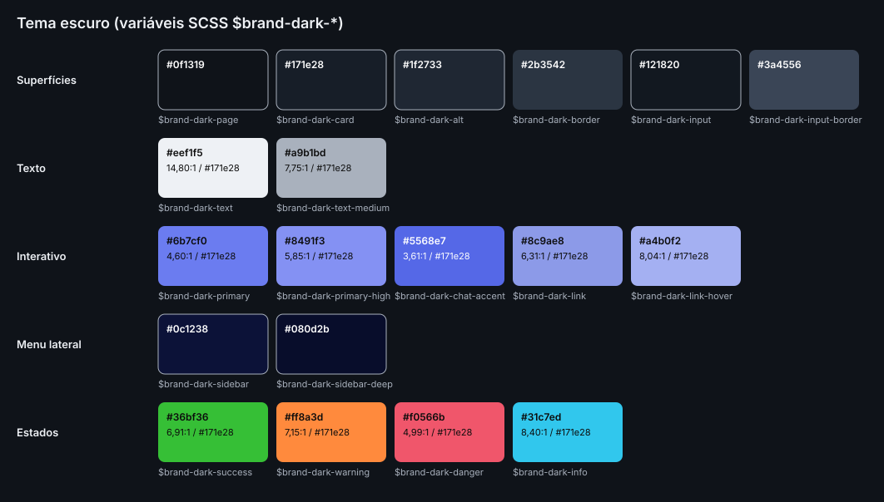
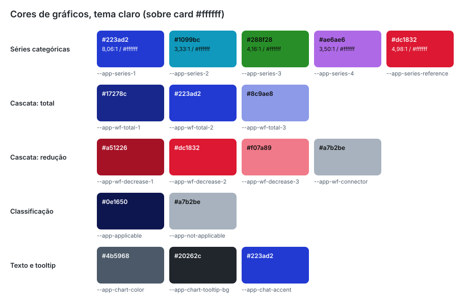
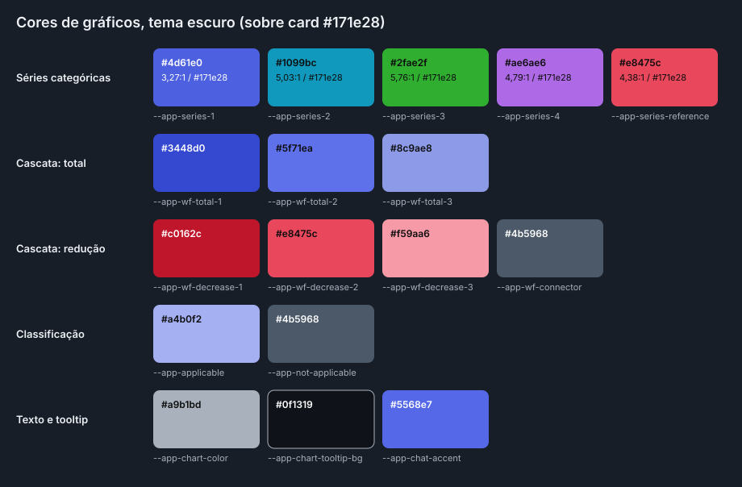

# 01. Identidade e tokens

Marca, paleta, sobrescritas do CoreUI e tema escuro da Agenda Normativa. Fonte da verdade: `anexos/scss/_brand.scss`,
`anexos/scss/_variables.scss` e `anexos/scss/_theme-dark.scss`. As tabelas da seção 4 foram geradas a partir desses três
arquivos (não digitadas à mão).

## 1. Princípios visuais

1. **Moldura escura, conteúdo claro.** Menu lateral e rodapé em azul-marinho (`#0e1650`); header branco com filete
   inferior; página em cinza muito claro (`#f3f5f7`); conteúdo em cards brancos.
2. **Cards leves.** Borda de 1 px `#dbe0e5`, raio de 16 px e sombra quase imperceptível
   (`0 2px 8px 0 rgba(11, 23, 35, .06)`). Nada de sombra pesada em repouso.
3. **Um azul de ação.** `#223ad2` (azul da marca) marca tudo o que é ativo, selecionado, focado ou clicável principal. O
   ciano da marca (`#31c7ed`) aparece só como detalhe sobre o azul-marinho (filete e ícone do item ativo do menu, foco na
   sidebar) e no brilho/anel dos cards de segmento.
4. **Formas por função.** Cards em 16 px; botões, inputs, itens de menu e legendas em 8 px; chips, seletor segmentado,
   selos, botões de exportar e barras de progresso em pílula.
5. **Tipografia Inter.** Títulos 600 com `letter-spacing: -.01em`; textos auxiliares em 13 px; cabeçalho de tabela em
   12 px maiúsculo; todos os números com dígitos tabulares.
6. **Gráficos limpos.** Sem números no eixo Y: o valor vai escrito no ponto ou na barra; grade só horizontal e discreta;
   legenda própria em HTML (clicável), nunca a do Chart.js.
7. **Cor nunca é o único código.** Séries validadas para daltonismo, linha de referência tracejada, valores escritos,
   visão "Tabela" equivalente a cada gráfico.
8. **Dois temas completos** (claro, escuro e automático) feitos só com variáveis CSS; componente novo funciona nos dois
   sem código extra.
9. **Movimento discreto.** Transições de 0,15 s a 0,2 s em cor, fundo, borda e opacidade; desligadas com
   `prefers-reduced-motion: reduce`.

Paleta da marca (gerada de `_brand.scss`):



Paleta do tema escuro (contraste calculado sobre o card escuro `#171e28`):



## 2. Marca

| Elemento | Especificação | Arquivo |
|---|---|---|
| Nome do produto | "Agenda Normativa" em `<title>`, `AppComponent.title` (via `Title`), `aria-label` do link da marca ("Agenda Normativa, ir para o início"), `workbook.creator` das planilhas e `<meta name="description">` | `anexos/index.html`, `app.component.ts`, `default-layout.component.html`, `xlsx-export.ts.txt` |
| Assinatura (wordmark) | "Agenda" em Inter 400 + "Normativa" em Inter 700 (`<strong>`); 1,0625rem (17 px), `line-height: 1`, `letter-spacing: -.01em`, branco, sem quebra (`.brand-name`) | `_components.scss` |
| Símbolo na sidebar | `brand-mark-white.svg` (dois `path` brancos, `viewBox` recortado ao desenho), `height: 1.75rem` (28 px), largura automática, atributos `width="32" height="28"`, `alt=""` e `aria-hidden="true"` (decorativo: o nome é texto). Espaço até o nome: `.625rem` | `anexos/assets/img/brand/brand-mark-white.svg`, `.brand-mark` |
| Símbolo para fundo claro | `brand-mark.svg`, mesmo desenho em `#002bab`. Guardado, sem uso na origem | `anexos/assets/img/brand/brand-mark.svg` |
| Favicon | SVG 32 × 32 (`viewBox 0 0 40 40`): quadrado `#002bab` com `rx="9"` e o símbolo branco | `anexos/assets/favicon.svg` |
| Logo do rodapé | `brand-logo-white.svg` (símbolo + "banco"), `height: 2.5rem`, `width="54" height="40"`, `alt` = nome da instituição (placeholder `NOME_DA_MARCA`) | `default-footer.component.*` |
| Cor da barra do navegador | `<meta name="theme-color">` `#223ad2` (claro) e `#0f1319` (escuro) com `media="(prefers-color-scheme: ...)"` | `anexos/index.html` |
| Link da marca | `.brand-lockup`: `inline-flex`, centralizado, branco em todos os estados, sem sublinhado; foco `outline: 2px solid var(--brand-highlight)`, `outline-offset: 4px`, raio `--brand-radius-xs` | `_components.scss` |
| Faixa da marca | `.sidebar-brand` alinhada à esquerda, `padding: 0 1.125rem`, borda inferior `1px rgba(255,255,255,.08)`, fundo `$sidebar-brand-bg` (`#0a1040`), altura padrão do CoreUI (4rem) | `_components.scss`, `_variables.scss` |

Regras da marca:

- O símbolo é o oficial da **instituição**, copiado do SVG público do site institucional por decisão do usuário (ADR-011 da origem).
  Não redesenhar, distorcer nem recolorir (só branco ou `#002bab`). Use somente em produtos da instituição.
- A fonte de títulos da marca (face display própria) é proprietária e **não** está incluída; títulos usam Inter 600.
- Nenhum logo, nome ou link do CoreUI aparece na interface, nos metadados ou no favicon (regra R8 da origem). O
  `LICENSE` MIT do template continua na raiz, por exigência da licença.
- Outra landing troca: `<title>`, `<meta name="description">`, `AppComponent.title`, `aria-label` da marca, texto do
  `.brand-name`, `workbook.creator` e, se não for produto da instituição, os SVG (mantendo as alturas de 1,75rem na sidebar e
  2,5rem no rodapé).

## 3. Arquitetura dos tokens

Três camadas, nesta ordem:

1. **Variáveis SCSS `$brand-*`** (`_brand.scss`): valores brutos da paleta, superfícies, raios, elevações e fonte. Únicos
   hex do projeto, junto com `_theme-dark.scss`.
2. **Propriedades CSS** em `:root` (`_brand.scss`): `--brand-*` (marca e semântica), `--app-chart-*`, `--app-series-*`,
   `--app-wf-*`, `--app-applicable`, `--app-not-applicable`, `--app-chat-accent`, `--app-export-*`. O tema escuro
   redefine essas propriedades em `:root[data-theme="dark"]` (`_theme-dark.scss`), exceto as de exportação: a planilha
   é sempre clara.
3. **Sobrescritas do CoreUI** (`_variables.scss`): `$primary`, `$card-border-radius`, `$sidebar-bg` etc. apontando para
   `$brand-*`. Como o arquivo é importado **antes** de `@coreui/coreui/scss/coreui`, todas as `--cui-*` geradas pelo CoreUI
   já nascem com a marca.

Ordem de importação real de `styles.scss` (não mudar):

```scss
@import "brand";                                   // $brand-* e :root (claro)
@import "variables";                               // sobrescritas do CoreUI com $brand-*
$enable-ltr: true;
$enable-rtl: true;
@import "@coreui/coreui/scss/coreui";
@import "@coreui/chartjs/scss/coreui-chartjs";     // tooltip HTML dos gráficos
@import "layout";                                  // .wrapper, fundo da página
@import "chat-widget";                             // só se houver o chat flutuante
@import "fixes";                                   // c-chart encolhe; importa scrollbar e charts
@import "theme-dark";                              // :root[data-theme="dark"]
@import "custom";                                  // typography, components, filter-chips e parciais de componentes
```

`_custom.scss` importa, em ordem: `typography`, `components`, `filter-chips`, `emails-card`, `stat-card`,
`classification-card`, `analytic-table`. Os quatro últimos são de componentes específicos da origem.

Regra de uso em componentes: `var(--brand-*)`, `var(--cui-*)` ou `var(--app-*)`. Nunca `#hex`, `rgb()` ou nome de cor em
`.component.scss`, template ou TypeScript. Para transparência sobre a cor primária use
`rgba(var(--brand-primary-rgb), alfa)`; para branco e preto, `rgb(var(--cui-white-rgb))` e `rgba(var(--cui-black-rgb), alfa)`.

Exceções aceitas na origem, todas fora do sistema de tokens:

- **Valores de reserva em TypeScript** para quando o canvas não consegue ler o CSS (testes, elemento desanexado). Eles
  repetem os valores claros de `_brand.scss` e precisam mudar junto: `fallbackColor` em `TRAFFIC_SERIES`
  (`dashboard-charts-data.ts`), `FALLBACK_TOTAL`/`FALLBACK_DECREASE` (cascata), `FALLBACK_APPLICABLE`/
  `FALLBACK_NOT_APPLICABLE` (rosca), `'#666'`/`'#fff'` no plugin de rótulos, `DARK_INK #0b0b0b`/`LIGHT_INK #ffffff` na
  cascata.
- **Cards de demonstração** herdados do template (página Início, cores de redes sociais `#3b5998`, `#00aced`,
  `#4875b4`): não fazem parte da identidade e não devem ser copiados para o produto.
- **SVG de marca**, que têm cor própria por natureza.

## 4. Tabelas de tokens

### Variáveis SCSS `$brand-*`

| Variável | Valor | Uso |
|---|---|---|
| `$brand-blue` | `#223ad2` | Primário / interativo puro. `$primary` do CoreUI, `--brand-primary`, `--app-series-1`, `--app-wf-total-2`. |
| `$brand-blue-high` | `#192a9a` | Hover e pressed do primário. `$link-hover-color`, `--brand-primary-high`. |
| `$brand-blue-deep` | `#17278c` | `--app-wf-total-1`. |
| `$brand-blue-light` | `#cad0f6` | `--brand-primary-light`. |
| `$brand-blue-low` | `#edeffc` | Fundos tingidos (chip ativo, item de menu ativo). `--brand-primary-low`. |
| `$brand-navy` | `#0e1650` | Fundo do menu lateral (derivado de blue-high). `$sidebar-bg`, `--brand-sidebar`. |
| `$brand-navy-deep` | `#0a1040` | Faixa da marca do menu lateral. `$sidebar-brand-bg`, `--brand-sidebar-deep`. |
| `$brand-cyan` | `#31c7ed` | Destaque / secundário puro. `--brand-highlight`; filete do item ativo da sidebar. |
| `$brand-cyan-dark` | `#1099bc` | `$info`, `--brand-highlight-dark`, `--app-series-2`. |
| `$brand-cyan-high` | `#0a5c71` | `--brand-highlight-high`: início do degradê petróleo dos cards de segmento do Scalation. |
| `$brand-cyan-low` | `#ecfafd` | `--brand-highlight-low`. |
| `$brand-pink` | `#e44e83` | Terciário. `--brand-tertiary`. |
| `$brand-pink-dark` | `#dd2264` | Reservado. |
| `$brand-pink-low` | `#fdf2f6` | Reservado. |
| `$brand-purple` | `#ae6ae6` | Acento. `--brand-accent`, `--app-series-4`. |
| `$brand-green` | `#36bf36` | Sucesso puro, só para preenchimentos. `--brand-success-pure`. |
| `$brand-green-dark` | `#288f28` | Sucesso para texto e botões (4,16:1 sobre branco). `$success`, `--brand-success`, `--app-series-3`. |
| `$brand-green-high` | `#1b601b` | Reservado. |
| `$brand-green-low` | `#effaef` | `--brand-success-low`. |
| `$brand-orange` | `#ff6600` | Alerta puro. `$warning`, `--brand-warning`. |
| `$brand-orange-dark` | `#b84900` | Alerta para texto (5,26:1 sobre branco). `--brand-warning-dark`. |
| `$brand-orange-high` | `#8a3700` | Reservado. |
| `$brand-orange-low` | `#fff3eb` | `--brand-warning-low`. |
| `$brand-red` | `#dc1832` | Erro puro. `$danger`, `--brand-danger`, `--app-series-reference`, `--app-wf-decrease-2`. |
| `$brand-red-dark` | `#a51226` | `--brand-danger-dark`, `--app-wf-decrease-1`. |
| `$brand-red-high` | `#931022` | Reservado. |
| `$brand-red-low` | `#fdedef` | `--brand-danger-low`. |
| `$brand-content-high` | `#20262c` | Texto principal. `$body-color`, `$high-emphasis`, `$dark`, `--brand-content-high`, `--app-chart-tooltip-bg`. |
| `$brand-content-pure` | `#363f4a` | `--brand-content-pure`. |
| `$brand-content-low` | `#4b5968` | Texto secundário. `$secondary`, `$medium-emphasis`, `--brand-content-low`, `--app-chart-color`. |
| `$brand-content-disabled` | `#a7b2be` | Desabilitado e decorativo. `$disabled`, `--brand-content-disabled`, `--app-wf-connector`. |
| `$brand-surface-page` | `#f3f5f7` | Fundo da página. `$light`, `--brand-surface-page`. |
| `$brand-surface-card` | `#ffffff` | Fundo de cards, header e footer. `$body-bg`, `--brand-surface-card`. |
| `$brand-surface-mid` | `#eaedf0` | Fundo do seletor segmentado, hover de chips. `--brand-surface-mid`. |
| `$brand-surface-high` | `#dbe0e5` | `--brand-surface-high`. |
| `$brand-border` | `#dbe0e5` | Bordas. `$border-color`, `$card-border-color`, `--brand-border`. |
| `$brand-input-border` | `#c5ccd4` | `$input-border-color`. |
| `$brand-overlay` | `#0f1319` | Cor de sobreposição da marca; origem do fundo escuro. |
| `$brand-dark-page` | `#0f1319` | Fundo da página no escuro. |
| `$brand-dark-card` | `#171e28` | Fundo de card no escuro (superfície usada na validação da paleta). |
| `$brand-dark-alt` | `#1f2733` | Superfície intermediária no escuro. |
| `$brand-dark-border` | `#2b3542` | Bordas no escuro. |
| `$brand-dark-input` | `#121820` | Fundo de inputs no escuro. |
| `$brand-dark-input-border` | `#3a4556` | Borda de inputs no escuro. |
| `$brand-dark-text` | `#eef1f5` | Texto principal no escuro. |
| `$brand-dark-text-medium` | `#a9b1bd` | Texto secundário no escuro. |
| `$brand-dark-text-disabled` | `rgba(255, 255, 255, .38)` | Desabilitado no escuro. |
| `$brand-dark-primary` | `#6b7cf0` | Primário no escuro (4,60:1 sobre `#171e28`). |
| `$brand-dark-primary-high` | `#8491f3` | Hover do primário no escuro. |
| `$brand-dark-primary-low` | `rgba(107, 124, 240, .16)` | Fundo tingido no escuro. |
| `$brand-dark-chat-accent` | `#5568e7` | Fundo do chat no escuro (`--app-chat-accent`): branco a 4,65:1. |
| `$brand-dark-link` | `#8c9ae8` | Links no escuro; `--brand-primary-light` escuro; `--app-wf-total-3`. |
| `$brand-dark-link-hover` | `#a4b0f2` | Hover de links no escuro. |
| `$brand-dark-sidebar` | `#0c1238` | Menu lateral no escuro. |
| `$brand-dark-sidebar-deep` | `#080d2b` | Faixa da marca no escuro. |
| `$brand-dark-success` | `#36bf36` | Sucesso no escuro. |
| `$brand-dark-warning` | `#ff8a3d` | Alerta no escuro. |
| `$brand-dark-danger` | `#f0566b` | Erro no escuro. |
| `$brand-dark-info` | `#31c7ed` | Informação no escuro. |
| `$brand-radius-xs` | `.25rem` | Raio 4 px: itens de dropdown, canto do balão do botão do chat. |
| `$brand-radius-sm` | `.5rem` | Raio 8 px: botões, inputs, itens de menu, legendas, tooltip, faixas de filtro. |
| `$brand-radius-md` | `1rem` | Raio 16 px: cards, bolhas e campo de texto do chat. |
| `$brand-radius-lg` | `1.5rem` | Raio 24 px: painel do chat. |
| `$brand-radius-pill` | `100px` | Pílula: chips, segmentado, selos, botão de tema, botões de exportar, progresso, barras de rolagem. |
| `$brand-elevation-1` | `0 4px 4px -2px rgba(11, 23, 35, .24)` | Nível 1. `$box-shadow-sm`. |
| `$brand-elevation-2` | `0 4px 12px 0 rgba(11, 23, 35, .12)` | Nível 2. `$box-shadow`; dropdowns. |
| `$brand-elevation-3` | `0 16px 32px 0 rgba(11, 23, 35, .32)` | Nível 3. `$box-shadow-lg`. |
| `$brand-elevation-card` | `0 2px 8px 0 rgba(11, 23, 35, .06)` | Nível 2 suavizado para cards em repouso. `$card-box-shadow`. |
| `$brand-font-family` | `"Inter", system-ui, -apple-system, "Segoe UI", Roboto, "Helvetica Neue", Arial, sans-serif` | `$font-family-sans-serif`, `--brand-font-family`, `--app-chart-font-family`. |

### Propriedades CSS: tema claro e tema escuro

| Token | Claro | Escuro | Uso |
|---|---|---|---|
| `--brand-primary` | `#223ad2` | `#6b7cf0` | Ações primárias, chip ativo, foco, filete da legenda. |
| `--brand-primary-high` | `#192a9a` | `#8491f3` | Hover/pressed do primário; chip ativo em hover. |
| `--brand-primary-low` | `#edeffc` | `rgba(107, 124, 240, .16)` | Fundo de chip ativo, item de legenda ativo, item de dropdown ativo, hover do botão de tema. |
| `--brand-primary-light` | `#cad0f6` | `#8c9ae8` | Tom claro do primário (sem uso direto no momento). |
| `--brand-primary-rgb` | `34, 58, 210` | `107, 124, 240` | Para `rgba(var(--brand-primary-rgb), a)` (anel de foco de input, hover do segmentado, borda da legenda ativa). |
| `--brand-highlight` | `#31c7ed` | `#31c7ed` | Filete e ícone do item ativo da sidebar; foco na sidebar, na marca e no chat; brilho e anel de filtro do `.brand-stat-card`. |
| `--brand-highlight-dark` | `#1099bc` | `#1099bc` | Status "precisa de mais informação" no chat. |
| `--brand-highlight-low` | `#ecfafd` | `rgba(49, 199, 237, .14)` | Fundo tingido de destaque (sem uso direto no momento). |
| `--brand-highlight-high` | `#0a5c71` | (herda o claro) | Tom petróleo dos cards de segmento (`tone="petrol"`): degradê até `--brand-sidebar`, texto branco ≥ 7:1 nas duas pontas; texto do selo ativo. |
| `--brand-tertiary` | `#e44e83` | (herda o claro) | Terciário (sem uso direto no momento). |
| `--brand-accent` | `#ae6ae6` | (herda o claro) | Acento (sem uso direto; o roxo entra como `--app-series-4`). |
| `--brand-success` | `#288f28` | `#36bf36` | Sucesso em texto e botões; status "resposta" no chat. |
| `--brand-success-pure` | `#36bf36` | (herda o claro) | Sucesso em preenchimentos; bolinha de conversa ativa no botão do chat. |
| `--brand-success-low` | `#effaef` | `rgba(54, 191, 54, .14)` | Fundo de sucesso (sem uso direto no momento). |
| `--brand-warning` | `#ff6600` | `#ff8a3d` | Alerta; status "fora do escopo" e "sem dados" no chat. |
| `--brand-warning-dark` | `#b84900` | `#ff6600` | Alerta em texto sobre fundo claro (sem uso direto no momento). |
| `--brand-warning-low` | `#fff3eb` | `rgba(255, 138, 61, .14)` | Fundo de alerta (sem uso direto no momento). |
| `--brand-danger` | `#dc1832` | `#f0566b` | Erro; filete de erro e contador no limite do chat. |
| `--brand-danger-dark` | `#a51226` | `#dc1832` | Erro em hover/texto (sem uso direto no momento). |
| `--brand-danger-low` | `#fdedef` | `rgba(240, 86, 107, .14)` | Fundo da mensagem de erro do chat. |
| `--brand-content-high` | `#20262c` | `#eef1f5` | Títulos, texto principal, item ativo do breadcrumb. |
| `--brand-content-pure` | `#363f4a` | `#eef1f5` | Texto (sem uso direto no momento). |
| `--brand-content-low` | `#4b5968` | `#a9b1bd` | Texto secundário, subtítulos, chips em repouso, cabeçalho de tabela, data do header. |
| `--brand-content-disabled` | `#a7b2be` | `rgba(255, 255, 255, .38)` | Desabilitado, divisor do breadcrumb, polegar da barra de rolagem. |
| `--brand-surface-page` | `#f3f5f7` | `#0f1319` | Fundo da página (`.wrapper.bg-light` em `_layout.scss`). |
| `--brand-surface-card` | `#ffffff` | `#171e28` | Cards (via `$body-bg`), chips em repouso no claro, painel do chat. |
| `--brand-surface-mid` | `#eaedf0` | `#1f2733` | Trilho do `.brand-segmented`, hover de chips/legenda/toggler do header, `.progress-thin`. |
| `--brand-surface-high` | `#dbe0e5` | `#2b3542` | Polegar das barras de rolagem internas das tabelas; botão Enviar desabilitado no chat. |
| `--brand-border` | `#dbe0e5` | `#2b3542` | Bordas de card, header, footer, chips, dropdown. |
| `--brand-sidebar` | `#0e1650` | `#0c1238` | Fim do degradê petróleo dos cards de segmento (`tone="petrol"`). O fundo do menu vem de `$sidebar-bg` (mesmo valor). |
| `--brand-sidebar-deep` | `#0a1040` | `#080d2b` | Referência; a faixa da marca usa `$sidebar-brand-bg` (mesmo valor). |
| `--brand-radius-xs` | `.25rem` | (herda o claro) | Itens de dropdown; canto do balão do botão do chat. |
| `--brand-radius-sm` | `.5rem` | (herda o claro) | Botões, inputs, itens de menu, legenda, tooltip de gráfico. |
| `--brand-radius-md` | `1rem` | (herda o claro) | Cards (16px). |
| `--brand-radius-lg` | `1.5rem` | (herda o claro) | Painel do chat. |
| `--brand-radius-pill` | `100px` | (herda o claro) | Chips, segmentado, botão de tema, selos, progresso. |
| `--brand-elevation-1` | `0 4px 4px -2px rgba(11, 23, 35, .24)` | `0 4px 4px -2px rgba(0, 0, 0, .5)` | Botão ativo do segmentado; pílula "Ir para o fim" do chat. |
| `--brand-elevation-2` | `0 4px 12px 0 rgba(11, 23, 35, .12)` | `0 4px 12px 0 rgba(0, 0, 0, .4)` | Dropdown do header, tooltip de gráfico. |
| `--brand-elevation-3` | `0 16px 32px 0 rgba(11, 23, 35, .32)` | `0 16px 32px 0 rgba(0, 0, 0, .55)` | Painel do chat; modais e sobreposições. |
| `--brand-elevation-card` | `0 2px 8px 0 rgba(11, 23, 35, .06)` | `0 2px 8px 0 rgba(0, 0, 0, .3)` | Cards em repouso. |
| `--brand-font-family` | `"Inter", system-ui, -apple-system, "Segoe UI", Roboto, "Helvetica Neue", Arial, sans-serif` | (herda o claro) | Fonte do app. |
| `--app-chat-accent` | `#223ad2` | `#5568e7` | Fundo sob texto/ícone branco do chat (botão, cabeçalho do painel, bolhas do usuário). Contraste do branco: 8,06:1 no claro, 4,65:1 no escuro (o `--brand-primary` escuro dá 3,64:1). |
| `--app-chart-color` | `#4b5968` | `#a9b1bd` | Texto de eixos e rótulos de valor dos gráficos. |
| `--app-chart-grid-color` | `rgba(32, 38, 44, .08)` | `rgba(255, 255, 255, .08)` | Linhas de grade. |
| `--app-chart-tooltip-bg` | `#20262c` | `#0f1319` | Fundo do tooltip Chart.js. |
| `--app-chart-tooltip-color` | `#ffffff` | `#eef1f5` | Texto do tooltip. |
| `--app-chart-font-family` | `"Inter", system-ui, -apple-system, "Segoe UI", Roboto, "Helvetica Neue", Arial, sans-serif` | (herda o claro) | Fonte do canvas. |
| `--app-export-accent` | `#223ad2` | (herda o claro) | Planilhas exportadas: fundo do cabeçalho. A planilha é sempre clara, então não muda com o tema da tela. |
| `--app-export-muted` | `#4b5968` | (herda o claro) | Planilhas exportadas: subtítulo e filete da linha de totais. |
| `--app-series-1` | `#223ad2` | `#4d61e0` | Normativos Recebidos: Atacado. |
| `--app-series-2` | `#1099bc` | `#1099bc` | Normativos Recebidos: Corporativo. |
| `--app-series-3` | `#288f28` | `#2fae2f` | Normativos Recebidos: Plataforma. |
| `--app-series-4` | `#ae6ae6` | `#ae6ae6` | Normativos Recebidos: Varejo. |
| `--app-series-reference` | `#dc1832` | `#e8475c` | Normativos Recebidos: "Normas a Classificar" (linha tracejada). |
| `--app-wf-total-1` | `#17278c` | `#3448d0` | Cascata: 1.º componente de etapa total (mais escuro). |
| `--app-wf-total-2` | `#223ad2` | `#5f71ea` | Cascata: 2.º componente total; cor da legenda "Total". |
| `--app-wf-total-3` | `#8c9ae8` | `#8c9ae8` | Cascata: 3.º componente total (mais claro). |
| `--app-wf-decrease-1` | `#a51226` | `#c0162c` | Cascata: 1.º componente de redução. |
| `--app-wf-decrease-2` | `#dc1832` | `#e8475c` | Cascata: 2.º componente de redução; cor da legenda "Redução". |
| `--app-wf-decrease-3` | `#f07a89` | `#f59aa6` | Cascata: 3.º componente de redução. |
| `--app-wf-connector` | `#a7b2be` | `#4b5968` | Cascata: linha de saldo entre etapas (2,15:1 sobre o card claro, 2,34:1 sobre o escuro; traço fino decorativo, os saldos também estão na tabela e no tooltip). |
| `--app-applicable` | `#0e1650` | `#a4b0f2` | Classificação das normas: aplicáveis (fatia da pizza e barras de temas). Fora dos azuis dos segmentos. |
| `--app-not-applicable` | `#a7b2be` | `#4b5968` | Classificação das normas: não aplicáveis (cinza neutro; valores sempre escritos ao lado). |

### Variáveis `--cui-*` globais redefinidas no escuro

| Variável | Valor escuro |
|---|---|
| `--cui-body-bg` | `#0f1319` |
| `--cui-body-bg-rgb` | `15, 19, 25` |
| `--cui-body-color` | `#eef1f5` |
| `--cui-body-color-rgb` | `238, 241, 245` |
| `--cui-border-color` | `#2b3542` |
| `--cui-border-color-translucent` | `rgba(255, 255, 255, .1)` |
| `--cui-link-color` | `#8c9ae8` |
| `--cui-link-hover-color` | `#a4b0f2` |
| `--cui-highlight-bg` | `#5c4a12` |
| `--cui-primary` | `#6b7cf0` |
| `--cui-primary-rgb` | `107, 124, 240` |
| `--cui-info` | `#31c7ed` |
| `--cui-info-rgb` | `49, 199, 237` |
| `--cui-success` | `#36bf36` |
| `--cui-success-rgb` | `54, 191, 54` |
| `--cui-warning` | `#ff8a3d` |
| `--cui-warning-rgb` | `255, 138, 61` |
| `--cui-danger` | `#f0566b` |
| `--cui-danger-rgb` | `240, 86, 107` |
| `--cui-light` | `#1f2733` |
| `--cui-light-rgb` | `31, 39, 51` |
| `--cui-dark` | `#eef1f5` |
| `--cui-dark-rgb` | `238, 241, 245` |
| `--cui-input-color` | `#eef1f5` |
| `--cui-input-bg` | `#121820` |
| `--cui-input-border-color` | `#3a4556` |
| `--cui-form-select-color` | `#eef1f5` |
| `--cui-form-select-bg` | `#121820` |
| `--cui-form-select-border-color` | `#3a4556` |
| `--cui-input-group-addon-color` | `#eef1f5` |
| `--cui-input-group-addon-bg` | `#1f2733` |
| `--cui-input-group-addon-border-color` | `#3a4556` |
| `--cui-form-check-input-bg` | `#121820` |

### Sobrescritas do CoreUI (`_variables.scss`)

| Variável CoreUI | Valor | Valor resolvido |
|---|---|---|
| `$primary` | `$brand-blue` | `#223ad2` |
| `$secondary` | `$brand-content-low` | `#4b5968` |
| `$success` | `$brand-green-dark` | `#288f28` |
| `$info` | `$brand-cyan-dark` | `#1099bc` |
| `$warning` | `$brand-orange` | `#ff6600` |
| `$danger` | `$brand-red` | `#dc1832` |
| `$light` | `$brand-surface-page` | `#f3f5f7` |
| `$dark` | `$brand-content-high` | `#20262c` |
| `$high-emphasis` | `$brand-content-high` | `#20262c` |
| `$medium-emphasis` | `$brand-content-low` | `#4b5968` |
| `$disabled` | `$brand-content-disabled` | `#a7b2be` |
| `$body-bg` | `$brand-surface-card` | `#ffffff` |
| `$body-color` | `$brand-content-high` | `#20262c` |
| `$link-color` | `$brand-blue` | `#223ad2` |
| `$link-hover-color` | `$brand-blue-high` | `#192a9a` |
| `$border-color` | `$brand-border` | `#dbe0e5` |
| `$font-family-sans-serif` | `$brand-font-family` | `"Inter", system-ui, -apple-system, "Segoe UI", Roboto, "Helvetica Neue", Arial, sans-serif` |
| `$font-weight-semibold` | `600` | `600` |
| `$headings-font-weight` | `600` | `600` |
| `$border-radius` | `$brand-radius-sm` | `.5rem` |
| `$border-radius-sm` | `$brand-radius-xs` | `.25rem` |
| `$border-radius-lg` | `$brand-radius-md` | `1rem` |
| `$border-radius-xl` | `$brand-radius-lg` | `1.5rem` |
| `$box-shadow` | `$brand-elevation-2` | `0 4px 12px 0 rgba(11, 23, 35, .12)` |
| `$box-shadow-sm` | `$brand-elevation-1` | `0 4px 4px -2px rgba(11, 23, 35, .24)` |
| `$box-shadow-lg` | `$brand-elevation-3` | `0 16px 32px 0 rgba(11, 23, 35, .32)` |
| `$card-border-radius` | `$brand-radius-md` | `1rem` |
| `$card-border-color` | `$brand-border` | `#dbe0e5` |
| `$card-box-shadow` | `$brand-elevation-card` | `0 2px 8px 0 rgba(11, 23, 35, .06)` |
| `$card-cap-bg` | `transparent` | `transparent` |
| `$btn-font-weight` | `500` | `500` |
| `$input-border-color` | `$brand-input-border` | `#c5ccd4` |
| `$badge-border-radius` | `$brand-radius-pill` | `100px` |
| `$badge-font-weight` | `600` | `600` |
| `$progress-border-radius` | `$brand-radius-pill` | `100px` |
| `$table-striped-bg` | `rgba(32, 38, 44, .03)` | `rgba(32, 38, 44, .03)` |
| `$breadcrumb-divider-color` | `$brand-content-disabled` | `#a7b2be` |
| `$breadcrumb-active-color` | `$brand-content-low` | `#4b5968` |
| `$sidebar-bg` | `$brand-navy` | `#0e1650` |
| `$sidebar-brand-bg` | `$brand-navy-deep` | `#0a1040` |
| `$sidebar-nav-title-color` | `rgba(255, 255, 255, .5)` | `rgba(255, 255, 255, .5)` |
| `$sidebar-nav-link-color` | `rgba(255, 255, 255, .72)` | `rgba(255, 255, 255, .72)` |
| `$sidebar-nav-link-icon-color` | `rgba(255, 255, 255, .6)` | `rgba(255, 255, 255, .6)` |
| `$sidebar-nav-link-hover-bg` | `rgba(255, 255, 255, .06)` | `rgba(255, 255, 255, .06)` |
| `$sidebar-nav-link-active-bg` | `rgba(255, 255, 255, .1)` | `rgba(255, 255, 255, .1)` |
| `$sidebar-nav-group-bg` | `rgba(0, 0, 0, .18)` | `rgba(0, 0, 0, .18)` |
| `$sidebar-nav-group-indicator-color` | `rgba(255, 255, 255, .6)` | `rgba(255, 255, 255, .6)` |
| `$header-bg` | `$brand-surface-card` | `#ffffff` |
| `$header-border-color` | `$brand-border` | `#dbe0e5` |
| `$footer-bg` | `$brand-navy` | `#0e1650` |
| `$footer-border-color` | `$brand-navy` | `#0e1650` |
| `$footer-color` | `rgba(255, 255, 255, .72)` | `rgba(255, 255, 255, .72)` |

### Raios e elevações em resumo

| Nível | Valor | Onde |
|---|---|---|
| `--brand-radius-xs` | 4 px | Itens de dropdown, canto do balão do chat, foco da marca |
| `--brand-radius-sm` | 8 px | `.btn`, `.form-control`, `.form-select`, itens do menu, itens de legenda, linhas clicáveis, faixa de filtro, tooltip, contêiner de tabela rolável |
| `--brand-radius-md` | 16 px | `.card` (via `$card-border-radius`), bolhas e campo do chat |
| `--brand-radius-lg` | 24 px | Painel do chat |
| `--brand-radius-pill` | 100 px | Chips, `.brand-segmented`, selos, botão de tema, botões "Exportar Excel", `.progress-thin`, polegar das barras de rolagem |
| `--brand-elevation-card` | `0 2px 8px 0 rgba(11,23,35,.06)` | Cards em repouso |
| `--brand-elevation-1` | `0 4px 4px -2px rgba(11,23,35,.24)` | Botão ativo do segmentado |
| `--brand-elevation-2` | `0 4px 12px 0 rgba(11,23,35,.12)` | Dropdown do header, tooltip, botão do chat, card de segmento filtrado |
| `--brand-elevation-3` | `0 16px 32px 0 rgba(11,23,35,.32)` | Painel do chat, modais |

Cores de gráficos e do chat por tema (geradas dos tokens; contraste das séries sobre o card):





## 5. Tema escuro

O CoreUI 4 não tem modos de cor; o tema escuro é do projeto (decisão registrada no template, ADR-002). Não portar o
`ColorModeService` nem código de tema do CoreUI 5.

### 5.1 Mecanismo (`anexos/app/core/services/theme.service.ts.txt`)

1. `ThemeService` (`providedIn: 'root'`) guarda o modo (`'light' | 'dark' | 'auto'`) em `localStorage` na chave
   `landing-analitica.color-mode` (leitura e escrita em `try/catch`; sem armazenamento, vale só na sessão). Padrão:
   `'light'`. **Ao copiar, troque a chave pelo nome do projeto** (o template usa `frontend-template-angular.color-mode`).
2. `apply()` resolve o tema efetivo (`auto` consulta `matchMedia('(prefers-color-scheme: dark)')` e reage a mudanças do
   sistema) e, no `<html>`, define `data-theme="light|dark"` e alterna a classe `dark-theme`.
3. `applyChartDefaults()` lê `--app-chart-color`, `--app-chart-grid-color`, `--app-chart-font-family`,
   `--app-chart-tooltip-bg` e `--app-chart-tooltip-color` com `getComputedStyle(document.documentElement)` e copia para
   `Chart.defaults` (importação dinâmica de `chart.js`, para não pesar no bundle inicial): cor de texto, cor de borda
   (grade), família da fonte, fundo e cores do tooltip, `padding: 10`, `cornerRadius: 8`, título 600. Em seguida chama
   `chart.update('none')` em todas as instâncias.
4. `appliedTheme$` emite `'light' | 'dark'`; cada componente de gráfico assina com `takeUntil(destroy$)` e refaz as
   cores das séries lendo os tokens de novo.
5. `AppComponent` injeta o serviço no construtor para aplicar o modo salvo já no bootstrap.
6. O seletor fica no header (dropdown "Tema": Claro `cilSun`, Escuro `cilMoon`, Automático `cilContrast`).

A versão do template já tem o mecanismo, mas sem fonte nem tooltip nos defaults do Chart.js (diferença nas linhas
`fontFamily`, `tooltipBg`, `tooltipColor`, `Chart.register(...registerables)` e `tooltip.padding/cornerRadius/titleFont`).
Use a versão do anexo.

### 5.2 O que `_theme-dark.scss` sobrescreve

Dentro de `:root[data-theme="dark"]`, com `color-scheme: dark`:

| Grupo | Variáveis / seletores |
|---|---|
| Tokens da marca | Todos os `--brand-*` de cor e elevação (tabela da seção 4) |
| Gráficos e chat | `--app-chart-*`, `--app-series-*`, `--app-wf-*`, `--app-applicable`, `--app-not-applicable`, `--app-chat-accent` |
| CoreUI globais | `--cui-body-*`, `--cui-border-color(-translucent)`, `--cui-link-*`, `--cui-highlight-bg`, `--cui-primary/info/success/warning/danger/light/dark(-rgb)`, `--cui-input-*`, `--cui-form-select-*`, `--cui-input-group-addon-*`, `--cui-form-check-input-bg` |
| Layout | `.sidebar` (`--cui-sidebar-bg: #0c1238`, `--cui-sidebar-brand-bg: #080d2b`), `.header` (`--cui-header-*`), `.footer` (`--cui-footer-bg/border-color: #0c1238`, cor `rgba(255,255,255,.72)`) |
| Botões | `.btn-primary` (fundo `#6b7cf0`, hover/ativo `#8491f3`), `.btn-outline-primary` (texto `#8c9ae8`, borda e hover `#6b7cf0`), `.btn-outline-secondary` |
| Componentes | `.card` (`#171e28`, borda `#2b3542`, sombra `0 2px 8px rgba(0,0,0,.3)`), `.dropdown-menu`, `.nav`, `.nav-tabs`, `.nav-pills`, `.navbar`, `.accordion`, `.breadcrumb`, `.pagination`, `.progress`, `.list-group`, `.table`, `.table-light`, `.toast`, `.modal`, `.popover`, `.offcanvas`, `.callout` |
| Estados com cor fixa no CoreUI 4 | `.form-control:disabled/[readonly]`, `.form-select:disabled`, foco de `.form-control`/`.form-select` (borda `#6b7cf0`, anel `rgba(107,124,240,.25)`), seta do `.form-select` (SVG com traço `#c3c8d1`), `.form-check-input(:checked)`, `.btn-close` (`filter: invert(1) grayscale(100%) brightness(200%)`) |
| Utilitários | `.bg-light`, `.bg-white`, `.text-high-emphasis`, `.text-medium-emphasis`, `.text-disabled` (com `!important`), `scrollbar-color: #4b5968 transparent` |

Componentes com regra própria no escuro (fora do bloco acima):

- `.filter-chip` em `[data-theme="dark"]` (`_filter-chips.scss`): fundo transparente em repouso; hover com borda
  `--brand-content-low`; ativo com texto `--brand-primary-high`, fundo `--brand-primary-low` e borda `rgba(var(--brand-primary-rgb), .7)`.
- `.brand-stat-card` via `:host-context([data-theme="dark"])` (`widgets-dropdown.component.scss`): camada
  `linear-gradient(135deg, rgba(black, .16), rgba(black, .3))` sobre o degradê, porque o `--brand-primary` escuro é mais
  claro e o texto branco perderia contraste.

### 5.3 Regras

- Componente novo funciona nos dois temas sem código extra se usar só `var(--cui-*)`, `var(--brand-*)` ou `var(--app-*)`.
- Componente CoreUI com cor fixa no escuro: a correção entra em `_theme-dark.scss` (bloco `.classe { --cui-...: ... }`),
  nunca no `.component.scss`.
- Cor nova: primeiro `$brand-*` em `_brand.scss`, depois `--brand-*` em `:root`, depois o valor escuro em `_theme-dark.scss`;
  então atualizar o `docs/design-system.md` do projeto e o carimbo `tokens-hash`.
- Em gráfico, nunca ler `--cui-card-bg` do `document`: ela é definida em `.card`, então leia a partir do canvas ou do
  card (`04-graficos.md`, 1).

## 6. Trocar a paleta numa landing de outra marca

A estrutura (nomes de tokens, componentes, gráficos) independe dos valores. Para outra identidade:

1. Trocar os valores de `$brand-*` em `_brand.scss` (e, se quiser, o prefixo; nesse caso renomear em todos os parciais).
2. Recalcular as variantes escuras em `_brand.scss` (`$brand-dark-*`) e `_theme-dark.scss`, conferindo contraste
   (texto ≥ 4,5:1, componentes ≥ 3:1) contra `#171e28` ou a nova superfície de card escura.
3. **Revalidar a paleta de gráficos** nos dois temas com o procedimento de `04-graficos.md`, seção 9, antes de usar.
4. Manter os nomes `--app-series-*`, `--app-wf-*`, `--app-chart-*`: os componentes leem esses nomes.
