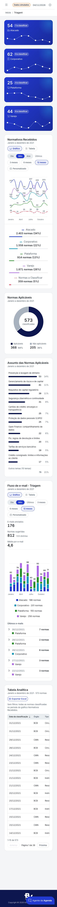

# 02. Tipografia e layout

Fonte, escala tipográfica, casca da página (sidebar, header, corpo, rodapé), grade, espaçamentos, camadas, rolagem e
comportamento de 375 px a 1440 px. Arquivos: `anexos/scss/_typography.scss`, `_components.scss`, `_layout.scss`,
`_fixes.scss`, `_scrollbar.scss` e `anexos/app/containers/`.

## 1. Fonte

### 1.1 Inter via `@fontsource/inter` 5.3.0

A fonte base da marca é a Inter. Ela entra como pacote npm (sem CDN, R2), registrada em `angular.json` nos arrays `styles`
de `build` **e** de `test`, antes de `src/scss/styles.scss`:

```json
"styles": [
  "node_modules/@fontsource/inter/latin-400.css",
  "node_modules/@fontsource/inter/latin-ext-400.css",
  "node_modules/@fontsource/inter/latin-500.css",
  "node_modules/@fontsource/inter/latin-ext-500.css",
  "node_modules/@fontsource/inter/latin-600.css",
  "node_modules/@fontsource/inter/latin-ext-600.css",
  "node_modules/@fontsource/inter/latin-700.css",
  "node_modules/@fontsource/inter/latin-ext-700.css",
  "src/scss/styles.scss"
]
```

Pesos usados: 400 (texto), 500 (botões, chips, menu, breadcrumb), 600 (títulos, valores, cabeçalhos), 700 (a
palavra "Normativa" da marca, "Agenda" no botão do chat e todo `<strong>` sem peso próprio, como o filtro
na faixa de filtro ativo e o valor do "Resultado" da cascata). Subconjuntos `latin` + `latin-ext` cobrem os acentos
do pt-BR. Instalação com versão exata: `npm install --save-exact @fontsource/inter@5.3.0` (só se o pacote existir no
Nexus).

### 1.2 Pilha

```scss
$brand-font-family: "Inter", system-ui, -apple-system, "Segoe UI", Roboto, "Helvetica Neue", Arial, sans-serif;
```

Usada por `$font-family-sans-serif` (CoreUI), `--brand-font-family` e `--app-chart-font-family` (canvas dos gráficos).

### 1.3 Sem o pacote

Se o Nexus não tiver `@fontsource/inter`, remova as oito linhas do `angular.json`. A pilha pode continuar começando por
`"Inter"`: sem o arquivo da fonte, o navegador cai para `system-ui` e o layout continua íntegro (as medidas são em rem e
não dependem da métrica da Inter). Registre a decisão no `docs/dependencias-e-ambiente.md` do projeto.

### 1.4 Texto desenhado em canvas

O canvas não herda CSS. Os gráficos leem `--app-chart-font-family` na hora de desenhar e usam sempre a mesma família:
eixos 11 px; rótulos de valor 600 11 px (linha) ou 600 12 px (barras); nome do componente na cascata 400 11 px.
Detalhes em `04-graficos.md`.

## 2. Escala tipográfica

Base de 16 px (`1rem`). Valores em rem com o equivalente em px.

| Elemento | Tamanho | Peso | Outros | Origem |
|---|---|---|---|---|
| `body` | 1rem (16) / 1,5 | 400 | `-webkit-font-smoothing: antialiased`, `-moz-osx-font-smoothing: grayscale`, `text-rendering: optimizeLegibility` | `_typography.scss` |
| `h1`–`h6`, `.h1`–`.h6` | padrão do CoreUI | 600 | `letter-spacing: -.01em`, cor `--brand-content-high` | `_typography.scss`, `$headings-font-weight` |
| Título de card (`h4.card-title.mb-0`) | 1,125rem (18) / 1,35 | 600 | `-.01em` | `.card-title` |
| Subtítulo de card (`div.small.text-medium-emphasis`) | 0,8125rem (13) / 1,4 | 400 | cor `--brand-content-low` | `small`, `.text-medium-emphasis` |
| `.card-header` | 0,9375rem (15) | 600 | `-.01em`, cor `--brand-content-high` | `_components.scss` |
| `small`, `.small` | 0,8125rem (13) / 1,4 | — | — | `_typography.scss` |
| Cabeçalho de tabela (`.table > thead th`) | 0,75rem (12) | 600 | `letter-spacing: .04em`, maiúsculas, `--brand-content-low` | `_typography.scss` |
| Corpo de tabela de dados | 0,8125rem (13) nas tabelas largas (`.analytic-table`, `.emails-normas-table`); 1rem nas demais | 400 | `font-variant-numeric: tabular-nums` em `td`/`th` | `_typography.scss`, parciais |
| Breadcrumb | 0,875rem (14) | 500 | links `--brand-content-low` → hover `--brand-primary`; atual `--brand-content-high`; divisor `--brand-content-disabled` | `_typography.scss` |
| Título de seção do menu (`.nav-title`) | 0,6875rem (11) / 1,2 | 600 | `letter-spacing: .06em`, maiúsculas (CoreUI), branco 48% | `_components.scss` |
| Item do menu (`.nav-link`) | 0,875rem (14) | 500 | branco 72% em repouso | `_components.scss` |
| Subitem do menu | 0,8125rem (13) | 400 | — | `.nav-group-items .nav-link` |
| Marca (`.brand-name`) | 1,0625rem (17) / 1 | 400 + 700 | `-.01em` | `_components.scss` |
| Data do header (`.header-date`) | 0,875rem (14) | 500 | `tabular-nums`, `--brand-content-low` | `_components.scss` |
| Cabeçalho do dropdown | 0,6875rem (11) | 600 | `.06em`, maiúsculas | `_components.scss` |
| Item do dropdown | 0,875rem (14) | 400 | — | `_components.scss` |
| Chip de filtro | 0,8125rem (13) / 1,25 | 500 (600 ativo) | — | `_filter-chips.scss` |
| Botão do segmentado | 0,8125rem (13) / 1,25 | 500 | — | `_components.scss` |
| Botões (`.btn`) | padrão CoreUI (`.btn-sm` 0,875rem) | 500 | — | `$btn-font-weight` |
| Valor do card de segmento | 1,75rem (28) / 1,15 | 600 | `-.02em`, `tabular-nums` | `widgets-dropdown.component.scss` |
| Nome do segmento no card | 0,875rem (14) | 500 | opacidade .9 | idem |
| Selo "N a classificar" | 0,75rem (12) / 1,4 | 600 | — | `_stat-card.scss` |
| Indicador (`dl.emails-stats dd`) | 1,5rem (24) / 1,2 | 600 | `tabular-nums`; rótulo `dt` 0,8125rem 400 `--brand-content-low`; nota 0,75rem | `emails-chart.component.scss` |
| Total no centro da rosca | 1,75rem (28) / 1,1 | 600 | `tabular-nums`; legenda "classificadas" 0,8125rem | `_classification-card.scss` |
| Valor da legenda da rosca | 1,25rem (20) | 600 | % ao lado em 0,875rem 500 `--brand-content-low` | idem |
| "Resultado" da cascata | 1,25rem (20) | 700 (`strong`) | `tabular-nums` | `waterfall-chart.component.scss` |
| Item de legenda do gráfico de linhas | 1rem (herdado) | rótulo 400 em `--brand-content-low`; total 600 | `tabular-nums` | `dashboard.component.scss` |
| Item de legenda do gráfico de barras | 0,875rem (14) | 400 | — | `_emails-card.scss` |
| Rodapé (`.footer`) | 0,8125rem (13); textos legais 0,75rem (12) / 1,5 | 400; nome e CNPJ 600 branco | — | `_components.scss`, `default-footer.component.scss` |
| Tooltip HTML do gráfico (`.chartjs-tooltip`) | 0,8125rem (13) | título 600 | corpo `tabular-nums` | `_charts.scss` |
| Links (`a`) | — | — | `text-decoration-thickness: 1px`, `text-underline-offset: .15em` | `_typography.scss` |

Observações:

- Os cabeçalhos ordenáveis da Tabela Analítica são botões (`.analytic-sort`); o reboot do CoreUI aplica
  `text-transform: none` em botões, então esses cabeçalhos **não** ficam em maiúsculas (ver captura em `06-telas.md`).
- Números sempre com dígitos tabulares: `.table td/th`, `.fs-4`, `.fs-5` e a utilidade `.tabular-nums`.

## 3. Casca da página

### 3.1 Estrutura (`anexos/app/containers/default-layout/default-layout.component.html`)

```html
<c-sidebar class="d-print-none sidebar sidebar-fixed" id="sidebar" visible>
  <c-sidebar-brand>
    <a routerLink="/" class="brand-lockup" aria-label="Agenda Normativa, ir para o início">
      
      <span class="brand-name">Agenda <strong>Normativa</strong></span>
    </a>
  </c-sidebar-brand>
  <perfect-scrollbar [config]="perfectScrollbarConfig">  <!-- { suppressScrollX: true } -->
    <c-sidebar-nav [navItems]="navItems" dropdownMode="none"></c-sidebar-nav>
  </perfect-scrollbar>
</c-sidebar>

<div class="wrapper d-flex flex-column min-vh-100 bg-light dark:bg-transparent">
  <app-default-header class="mb-4 d-print-none header header-sticky" position="sticky" sidebarId="sidebar"></app-default-header>
  <div class="body flex-grow-1 px-3">
    <c-container breakpoint="lg" class="h-auto">
      <router-outlet></router-outlet>
    </c-container>
  </div>
  <app-default-footer></app-default-footer>
</div>

<app-chat-widget class="d-print-none"></app-chat-widget>  <!-- só se houver o chat -->
```

### 3.2 Menu lateral

| Item | Especificação |
|---|---|
| Largura | 16rem (256 px, padrão do CoreUI 4). Sempre larga: sem modo estreito, sem `<c-sidebar-toggler>` no rodapé do menu |
| Fundo | `$sidebar-bg: #0e1650`; faixa da marca `$sidebar-brand-bg: #0a1040` (4rem de altura). Escuro: `#0c1238` / `#080d2b` |
| Abaixo de 992 px | O CoreUI esconde o menu; o botão `cilMenu` do header (`cHeaderToggler`, `[cSidebarToggle]="sidebarId"`, `toggle="visible"`) abre e fecha |
| Área de itens | `padding: .5rem .5rem .75rem; gap: .125rem`; rolagem vertical com `perfect-scrollbar` (`suppressScrollX: true`) |
| Título de seção ("PAINÉIS") | `--cui-sidebar-nav-title-padding-x: .875rem`, `-padding-y: .5rem`, `-margin-top: 1.25rem`; 11 px 600, branco 48% |
| Item | `--cui-sidebar-nav-link-padding-y: .5625rem`, `-padding-x: .875rem`; raio 8 px; 14 px 500; branco 72% |
| Ícone do item | caixa `1.25rem × 1.125rem`, `margin-right: .75rem`, opacidade .72 (1 em hover/ativo); ícone ativo em `--brand-highlight` |
| Hover | fundo `rgba(255,255,255,.06)`, texto e ícone brancos |
| Ativo | fundo `rgba(255,255,255,.1)` + filete `::before` de 3 px × 1,25rem em `--brand-highlight` na borda esquerda, raio `0 3px 3px 0`; anima de `opacity: 0; scaleY(.4)` para `opacity: 1; scaleY(1)` (0,15 s / 0,2 s) |
| Grupo aberto | `.nav-group.show` com fundo `rgba(0,0,0,.18)` e raio 8 px; seta do grupo branca 60% |
| Subitem | 13 px 400, sem ícone; ativo com o mesmo fundo e filete do item |
| Foco | `outline: 2px solid var(--brand-highlight); outline-offset: -2px` |
| Rolagem do menu | polegar `rgba(255,255,255,.22)` com borda na cor do menu |

Itens do menu (`anexos/app/containers/default-layout/_nav.ts.txt`): "Início" (`cil-home`, `routerLinkActiveOptions:
{ exact: true }` para não ficar ativo em toda página), título "Painéis", grupos com ícone (`cil-speedometer`,
`cil-layers`) cujos filhos abrem **seções da mesma página** por fragmento, e um item simples (`cil-chart-line`). O padrão
dos filhos:

```ts
const section = (name: string, url: string, fragment: string): INavData => ({
  name,
  url,
  linkProps: {
    fragment,
    routerLinkActiveOptions: { paths: 'exact', fragment: 'exact', queryParams: 'ignored', matrixParams: 'ignored' }
  }
});
```

`dropdownMode="none"` é obrigatório: o CoreUI 4 compara a URL do grupo com o endereço sem o fragmento e fecharia o
grupo a cada clique de seção. Como efeito colateral, a página aberta por um link de seção começa com o grupo fechado;
`DefaultLayoutComponent` resolve com `openActiveGroup()` (clica no toggle de todo grupo fechado que contém o link
ativo, depois de cada `NavigationEnd`).

### 3.3 Header

Duas linhas dentro de `app-default-header` (estende `HeaderComponent` do CoreUI), `position="sticky"`, altura mínima 4rem
(padrão do CoreUI), `mb-4` (1,5rem) até o conteúdo.

| Item | Especificação |
|---|---|
| Caixa | `--cui-header-padding-y: .5rem`, `-padding-x: 1rem`; fundo `$header-bg` (branco; escuro `#171e28`); borda inferior 1 px `--brand-border`; sem sombra |
| Linha 1, esquerda | Botão `cilMenu` `size="lg"`, `ariaLabel`/`title` "Alternar menu lateral"; cor `--brand-content-low`, raio 8 px; hover `--brand-content-high` sobre `--brand-surface-mid`; foco 2 px `--brand-primary` |
| Linha 1, direita | Data atual + seletor de tema (`c-header-nav class="ms-auto d-flex align-items-center"`) |
| Data | `<time class="nav-link header-date" [attr.datetime]="iso" [attr.title]="long">`; ≥ 768 px mostra a forma longa ("quarta-feira, 28 de outubro de 2026"), abaixo a curta ("28/10/2026"); `Intl.DateTimeFormat('pt-BR')`; recalculada a cada minuto (`interval(60000)` + `distinctUntilChanged`) para virar à meia-noite; `padding-right: .75rem` |
| Seletor de tema | Botão redondo `.theme-toggle` 2,25rem (36 px), sem borda, ícone do modo atual (`cilSun`/`cilMoon`/`cilContrast`, `size="lg"`), cor `--brand-content-low`; hover e aberto (`.show`) em `--brand-primary` sobre `--brand-primary-low`; foco 2 px `--brand-primary` com `offset 2px`; `aria-label`/`title` "Alterar tema" |
| Menu do seletor | `c-dropdown alignment="end" variant="nav-item"`; `min-width: 11rem`, `padding: .375rem`, borda `--brand-border`, raio 8 px, sombra `--brand-elevation-2`; cabeçalho "TEMA" (11 px 600 maiúsculo); itens com ícone `me-2`, 14 px, `padding: .5rem .75rem`, raio 4 px; ativo em `--brand-primary` sobre `--brand-primary-low` |
| Divisor | `c-header-divider` com `margin: .25rem 0` e cor `--brand-border` |
| Linha 2 | `<c-breadcrumb-router class="ms-2">` (títulos das rotas em `data.title`; a rota raiz tem `title: ''` para não repetir "Início") |

### 3.4 Corpo

- `div.body.flex-grow-1.px-3` (1rem de cada lado) com `min-width: 0` (não estoura em 375 px).
- `c-container breakpoint="lg"` (`.container-lg`): 100% da largura abaixo de 992 px; acima, centralizado com máximo de
  960 / 1140 / 1320 px conforme o breakpoint da janela.
- Páginas começam com `<h1 class="visually-hidden">Nome da página</h1>` (o título visível fica no breadcrumb e nos cards).
- Cada bloco alvo do menu tem `id` igual ao fragmento (kebab-case em pt-BR: `segmentos`, `normativos-recebidos`,
  `normas-aplicaveis`, `assunto-das-normas`, `fluxo-de-email`, `tabela-analitica`, `cascata`, `trafego-e-vendas`). Elementos
  customizados usados como seção recebem `class="page-section"` (`display: block`).

### 3.5 Rodapé

Faixa azul-marinho como o menu, no estilo do rodapé do site institucional, mais enxuta (`default-footer.component.*`).

| Item | Especificação |
|---|---|
| Caixa | `$footer-bg: #0e1650` (escuro `#0c1238`), texto `rgba(255,255,255,.72)`, `--cui-footer-padding-y: 1.25rem`, `-padding-x: 1.5rem`, 13 px |
| Conteúdo | Coluna centralizada (`flex-direction: column; gap: .75rem; align-items: center; text-align: center`) |
| Logo | `brand-logo-white.svg`, `height: 2.5rem` |
| Texto legal | `.footer-legal` com `max-width: 60rem`, 12 px / 1,5: "Copyright © {ano} todos os direitos reservados" e, por empresa, nome e CNPJ em `<strong>` branco 600 seguidos do endereço. Dados em `FOOTER_COMPANIES` (`default-footer.component.ts`): específicos da instituição, vêm da configuração de ambiente (nunca versionados; no anexo, placeholders) |
| O que não tem | Selos, links, redes sociais |

### 3.6 Wrapper e fundo

`_layout.scss`: `.wrapper` com `width: 100%`, `overflow-x: clip` (o tooltip HTML do Chart.js fica no DOM, invisível, na
última posição; sem o `clip` ele cria rolagem horizontal no celular; `clip` não quebra o header `sticky`), padding
lateral igual ao espaço ocupado pelo menu (`--cui-sidebar-occupy-start`) com transição de 0,15 s, e
`.wrapper.bg-light { background-color: var(--brand-surface-page) !important }`.

### 3.7 Impressão

Menu, header e chat têm `d-print-none`; a impressão sai só com o conteúdo e o rodapé.

## 4. Grade e espaçamento

| Item | Valor |
|---|---|
| Breakpoints (CoreUI 4) | `sm` 576, `md` 768, `lg` 992, `xl` 1200, `xxl` 1400 px |
| Gutter da grade | 1,5rem (`$grid-gutter-width`) |
| Escala de espaçamento | `$spacer: 1rem` → utilitários 1 = .25rem, 2 = .5rem, 3 = 1rem, 4 = 1,5rem, 5 = 3rem |
| Entre blocos verticais | `mb-4` (1,5rem) em todo card e linha de cards |
| Cards lado a lado | `<c-row class="mb-4 g-4">` com `h-100` nos cards (mesma altura) |
| Padding do card | `--cui-card-spacer-y/x: 1.25rem`; cabeçalho `--cui-card-cap-padding-y: .875rem`, `-x: 1.25rem`; `--cui-card-cap-bg: transparent` |
| Cabeçalho interno de card | `display: flex; flex-wrap: wrap; align-items: flex-start; justify-content: space-between; gap: .75rem 1rem` (título e subtítulo à esquerda, controles à direita, quebram juntos no celular) |
| Título → filtros | filtro de período com `mt-3` (1rem) |
| Filtros → gráfico | `margin-top: 24px` no gráfico de linhas; `mt-3 mb-2` na linha de resultado/legenda da cascata |
| Gráfico → legenda | legendas em HTML com `margin-top: .75rem` (barras) ou no `c-card-footer` (linhas) |
| Faixa de filtro | `mb-4` antes do bloco filtrado |

Grades usadas:

| Bloco | Colunas |
|---|---|
| Cards de segmento | `<c-col sm="6" xl="3">`: 1 por linha < 576 px, 2 de 576 a 1199 px, 4 a partir de 1200 px |
| Cards de classificação | `<c-col lg="5">` (rosca) + `<c-col lg="7">` (temas); empilhados < 992 px |
| Legenda do gráfico de linhas | `<c-row [md]="5" [xs]="1">`: 5 itens por linha ≥ 768 px, 1 abaixo |
| Indicadores do card de e-mails | `flex-wrap` com `gap: 1rem 2rem`; < 576 px dois por linha (`flex: 1 1 40%`) |

## 5. Camadas (`z-index`)

| Camada | Valor |
|---|---|
| Coluna fixa da tabela aninhada | 1 |
| Header (`sticky`) | 1020 (CoreUI) |
| Menu lateral (`fixed`) | 1030 (CoreUI) |
| Botão do chat | 1035 |
| Painel do chat | 1036 |
| Modais | 1055 (CoreUI) |

## 6. Rolagem até seções

- Roteamento por hash (`HashLocationStrategy`), então um subitem aponta para `#/triagent#normas-aplicaveis`.
- `RouterModule.forRoot` com `scrollPositionRestoration: 'top'`, `anchorScrolling: 'enabled'`,
  `scrollOffset: () => [0, stickyHeaderOffset()]` (borda inferior do header + 16 px) e
  `initialNavigation: 'enabledBlocking'`.
- `SectionScrollService` (`anexos/app/core/navigation/section-scroll.ts.txt`): como os cards acima da seção carregam
  dados depois e empurram o conteúdo, o serviço realinha a seção sempre que a altura da página muda
  (`ResizeObserver` no `body`) por até 2,5 s, e para no primeiro `wheel`, `touchstart`, `keydown` ou `mousedown` do
  usuário. Roda fora da zona do Angular.

## 7. Barras de rolagem

`_scrollbar.scss`: finas (`scrollbar-width: thin`; WebKit 10 px), trilho transparente com `margin-block: .25rem`,
polegar `--brand-content-disabled` em pílula com borda de 2 px na cor do fundo, hover `--brand-content-low`. No menu, polegar
branco 22%. Áreas roláveis internas (tabelas largas): barra de 8 px, polegar `--brand-surface-high`.

## 8. Responsividade (375 a 1440 px)

| Largura | Comportamento |
|---|---|
| < 576 px | Cards de segmento um por linha; linhas de tema com o nome acima da barra; lista de e-mails em duas linhas (data e contagem em cima, segmento embaixo); indicadores dois por linha; painel do chat em tela cheia (`inset: 0`, sem raio, "Expandir" oculto, botão flutuante oculto enquanto aberto) |
| < 768 px | Data curta no header; legenda do gráfico de linhas com um item por linha |
| < 992 px | Menu lateral escondido (abre pelo botão do header); cards de classificação empilhados |
| ≥ 1200 px | Quatro cards de segmento por linha |
| Qualquer | Cabeçalhos de card e barras de filtro quebram linha (`flex-wrap`); gráficos encolhem com a coluna (`.chart-wrapper, c-chart { display: block; max-width: 100%; min-width: 0 }`); tabelas largas rolam dentro do card (`.table-responsive`; `.analytic-scroll` com tabela de `min-width: 64rem`; `.emails-normas` com `56rem`); nenhuma rolagem horizontal na página |

Celular (375 px), página inteira:


