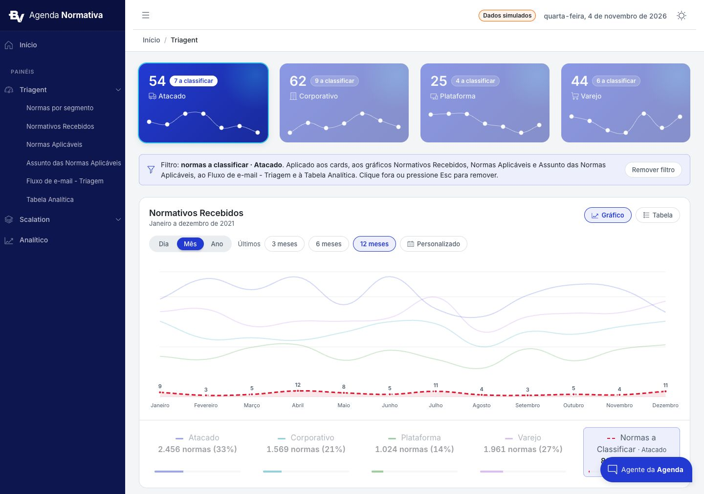
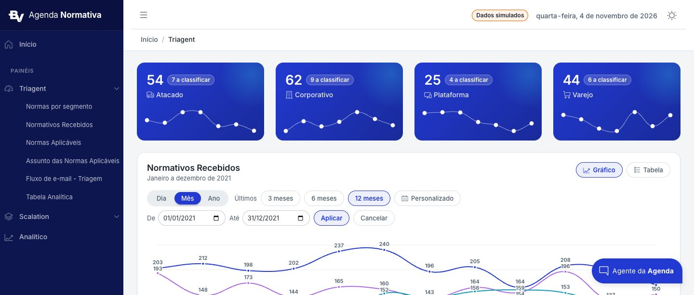
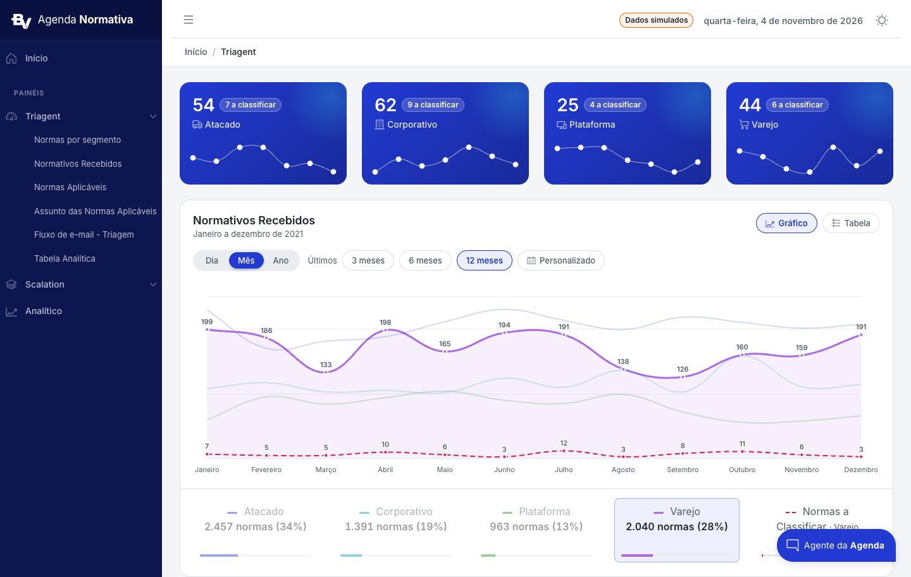
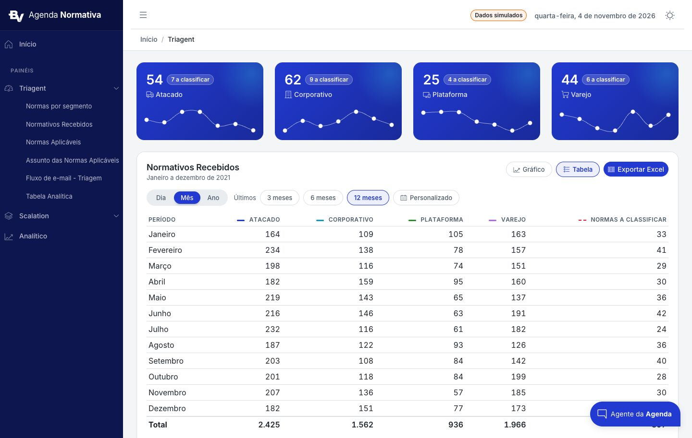
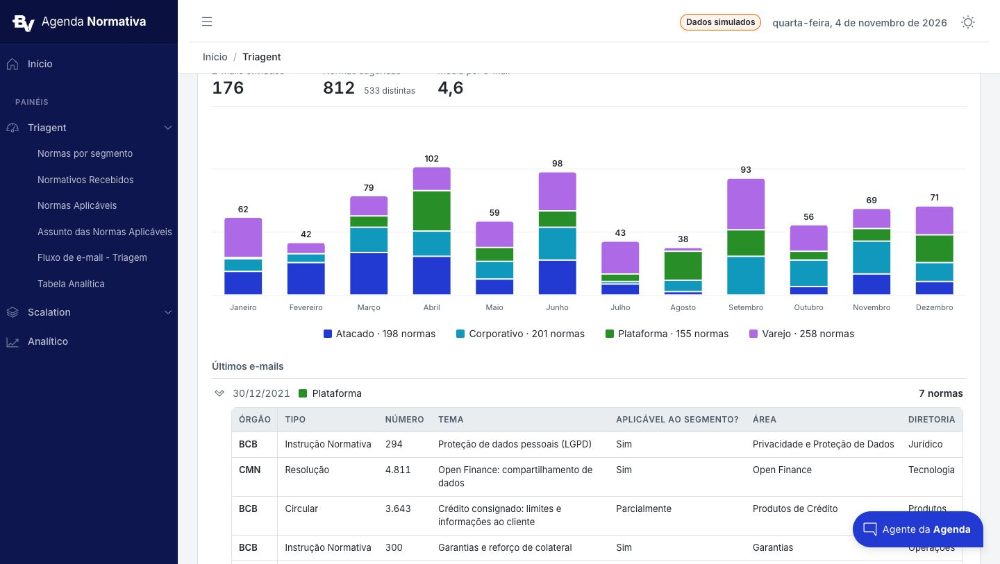
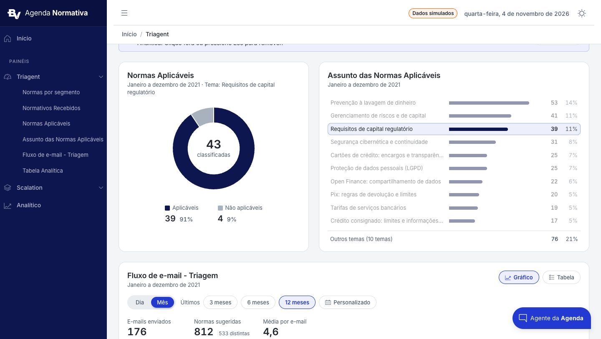
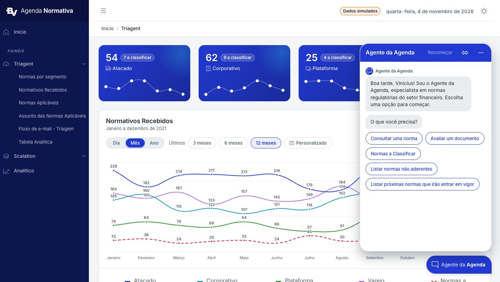
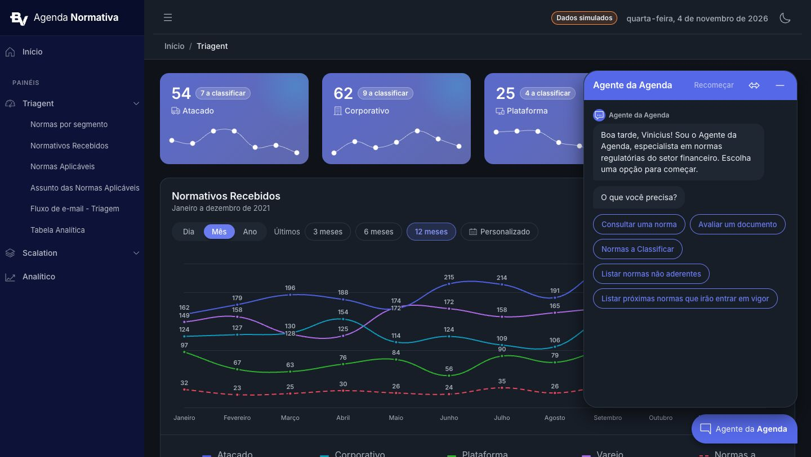

# 03. Componentes

Catálogo dos componentes de interface da Agenda Normativa: anatomia em HTML (Angular 15 + CoreUI 4), medidas, estados,
comportamento no tema escuro, acessibilidade e arquivo de origem. Todos leem só variáveis CSS; salvo indicação, o tema
escuro se aplica sozinho. Gráficos estão em `04-graficos.md`; textos padrão em `05-conteudo-e-acessibilidade.md`.

Convenção de nomes (ADR-009 da origem): prefixo `brand-` para utilitários do painel (`.brand-stat-card`, `.brand-segmented`,
`.brand-icon-btn`, `.brand-lockup`); nome do componente para classes específicas (`.traffic-*`, `.waterfall-*`, `.emails-*`,
`.analytic-*`); `.filter-*` para os controles de filtro compartilhados (não renomear).

## 1. Card padrão

Base de todo bloco de conteúdo.

```html
<c-card class="mb-4" aria-labelledby="exemplo-title">
  <c-card-body>
    <div class="exemplo-header">                         <!-- flex, wrap, space-between, gap .75rem 1rem -->
      <div>
        <h4 class="card-title mb-0" id="exemplo-title">Título do card</h4>
        <div class="small text-medium-emphasis">Janeiro a dezembro de 2021 · Atacado</div>
      </div>
      <div class="exemplo-controls">                     <!-- flex, wrap, align center, gap .5rem 1rem -->
        <!-- chips Gráfico/Tabela, botão Exportar Excel -->
      </div>
    </div>
    <app-period-filter class="d-block mt-3" label="Período do exemplo" ...></app-period-filter>
    <!-- conteúdo: gráfico, tabela, lista -->
  </c-card-body>
  <c-card-footer><!-- opcional: legenda --></c-card-footer>
</c-card>
```

| Item | Valor |
|---|---|
| Forma | Raio 16 px (`$card-border-radius`), borda 1 px `--brand-border`, sombra `--brand-elevation-card`, sem hover |
| Espaço interno | 1,25rem; cabeçalho e rodapé do card `.875rem 1.25rem`, fundo transparente, filete `--brand-border` |
| Título | `h4.card-title.mb-0`, 18 px 600, `--brand-content-high`, com `id` referenciado por `aria-labelledby` |
| Subtítulo | `div.small.text-medium-emphasis`, 13 px `--brand-content-low`. Conteúdo: período por extenso, seguido de `· filtro` quando houver ("Janeiro a dezembro de 2021 · Atacado", "· Tema: Pix"). Enquanto carrega: "Carregando período..." |
| Espaço entre cards | `mb-4`; lado a lado em `<c-row class="mb-4 g-4">` com `class="h-100"` nos cards |
| Escuro | Fundo `#171e28`, borda `#2b3542`, sombra `0 2px 8px rgba(0,0,0,.3)` |
| Arquivos | `_variables.scss` (`$card-*`), `_components.scss` (`.card`, `.card-header`, `.card-footer`), `_theme-dark.scss` (`.card`) |

## 2. Card de segmento (`.brand-stat-card`)



KPI por segmento em degradê, com selo de pendências e minigráfico. Usa `<c-widget-stat-a>` do CoreUI 4 com os
templates `widgetTitleTemplate`, `widgetValueTemplate` e `widgetChartTemplate` (o CoreUI mostra o valor em cima e o
título embaixo).

```html
<c-row>
  <c-col *ngFor="let segment of segments; index as i" sm="6" xl="3">
    <c-widget-stat-a class="mb-4 brand-stat-card"
      [class.is-filtered]="activeSegment === segment.id"
      [class.is-dimmed]="activeSegment !== null && activeSegment !== segment.id"
      [title]="segment.label">
      <ng-template cTemplateId="widgetTitleTemplate">
        <span class="d-inline-flex align-items-center gap-1">
          <svg cIcon [name]="segment.icon" class="segment-icon" aria-hidden="true"></svg>
          {{ segment.label }}
        </span>
      </ng-template>
      <ng-template cTemplateId="widgetValueTemplate">
        <span class="brand-stat-value">
          <span>{{ segment.total | number: '1.0-0' }}</span>
          <button type="button" class="brand-stat-pending" data-segment-filter
            [attr.aria-pressed]="activeSegment === segment.id"
            [attr.title]="'Filtrar a página pelas normas a classificar de ' + segment.label"
            (click)="selectToClassify(segment.id)">
            {{ segment.toClassify | number: '1.0-0' }} a classificar
          </button>
        </span>
      </ng-template>
      <ng-template cTemplateId="widgetChartTemplate">
        <c-chart [data]="data[i]" [options]="options[i]" class="brand-stat-chart" height="70" type="line"></c-chart>
      </ng-template>
    </c-widget-stat-a>
  </c-col>
</c-row>
```

| Item | Valor |
|---|---|
| Fundo | `--stat-bg` no `:host`. Tom padrão: `linear-gradient(135deg, var(--brand-primary) 0%, var(--brand-primary-high) 100%)`. Tom petróleo (`tone="petrol"`, classe `.tone-petrol` no host via `@HostBinding`): `linear-gradient(135deg, var(--brand-highlight-high) 0%, var(--brand-sidebar) 100%)`, texto branco ≥ 7:1 nas duas pontas |
| Brilho | `::after` de 9rem × 9rem em `top/right: -3rem`, `radial-gradient(circle, var(--brand-highlight), transparent 70%)`, opacidade .28, `pointer-events: none`; o card tem `position: relative; overflow: hidden; border: 0` |
| Texto | Branco (`rgb(var(--cui-white-rgb))`); valor 28 px 600 `-.02em` tabular; linha do nome 14 px 500, opacidade .9, `margin-top: .25rem`; ícone 1rem, opacidade .85 |
| Ícones por segmento | Atacado `cilTruck`, Corporativo `cilBuilding`, Plataforma `cilDevices`, Varejo `cilCart` (vêm do JSON de dados) |
| Selo `.brand-stat-pending` | Pílula translúcida: `padding: .125rem .5rem`, 12 px 600, fundo `rgba(255,255,255,.16)`, borda 1 px `rgba(255,255,255,.28)`. Como `<button>` (página com filtro): hover `.26`, foco contorno branco 2 px com `offset 2px`, ativo (`aria-pressed="true"`) invertido: fundo branco, texto `var(--stat-accent)` (azul ou petróleo). Como `<span>` (`[filterable]="false"`): só texto, `cursor: default` |
| Minigráfico | Linha branca 60% de 1 px com pontos brancos de 4 px, `tension .4`, eixos ocultos, 70 px de altura, `margin: .75rem 1rem 0` (configuração em `04-graficos.md`, 3) |
| Estados do card | `.is-filtered`: anel `0 0 0 2px var(--brand-highlight)` + `--brand-elevation-2`. `.is-dimmed`: opacidade .5. Transição .15 s em opacidade e sombra. Sem hover |
| Escuro | `:host-context([data-theme="dark"]) .brand-stat-card` sobrepõe `linear-gradient(135deg, rgba(black,.16), rgba(black,.3))` ao degradê (o azul escuro é mais claro e o branco perderia contraste) |
| Entradas/saídas | `@Input() activeSegment: string \| null`, `@Input() tone: 'primary' \| 'petrol'`, `@Input() filterable = true`, `@Output() toClassifySelect` (id do segmento) |
| Erro | `<p class="small text-medium-emphasis mb-4" role="alert">Não foi possível carregar os segmentos.</p>` |
| Arquivos | `widgets-dropdown.component.{html,ts,scss}` (`.scss` < 4 kB, usa `::ng-deep` só para `.fs-4` e a linha do título), `_stat-card.scss` (selo, global por causa do budget) |

## 3. Faixa de filtro ativo (`.segment-filter-notice`)

Aparece acima do bloco filtrado sempre que um filtro de página está ligado.

```html
<div *ngIf="segmentFilter" class="segment-filter-notice mb-4" role="status">
  <svg cIcon name="cilFilter" aria-hidden="true"></svg>
  <span>
    Filtro: <strong>normas a classificar · Atacado</strong>. Aplicado aos cards, aos gráficos ... e à Tabela Analítica.
    Clique fora ou pressione Esc para remover.
  </span>
  <button type="button" class="filter-chip" (click)="clearSegmentFilter()">Remover filtro</button>
</div>
```

| Item | Valor |
|---|---|
| Caixa | `display: flex; flex-wrap: wrap; align-items: center; gap: .5rem .75rem; padding: .625rem 1rem`; 14 px `--brand-content-high`; fundo `--brand-primary-low`; borda 1 px `rgba(var(--brand-primary-rgb), .25)`; raio 8 px |
| Ícone | `cilFilter` 1rem em `--brand-primary`, `flex-shrink: 0` |
| Texto | `flex: 1 1 16rem`; diz o filtro em negrito, onde ele vale e como remover |
| Ação | Chip "Remover filtro" |
| Arquivo | `dashboard.component.scss` (escopo do componente; para reutilizar em outra página, mover para `src/scss/`) |

Regras de filtro de página (`dashboard.component.ts`): `Esc` remove todos os filtros (`@HostListener('document:keydown.escape')`);
clique fora remove (`@HostListener('document:click')`), exceto em elementos com `data-segment-filter`,
`data-page-filter` ou dentro de `.sidebar` (os subitens do menu navegam na mesma página e mantêm o filtro); clicar de
novo no mesmo valor desliga. Os blocos afetados acrescentam `· <filtro>` ao subtítulo.

## 4. Chips de filtro (`.filter-bar`, `.filter-chip`, `.filter-date`)



```html
<div class="filter-bar" role="group" aria-label="Forma de exibição">
  <button type="button" class="filter-chip" [class.is-active]="view === 'chart'" [attr.aria-pressed]="view === 'chart'" (click)="setView('chart')">
    <svg cIcon name="cilChartLine" size="sm" aria-hidden="true"></svg>
    Gráfico
  </button>
  <button type="button" class="filter-chip" [class.is-active]="view === 'table'" [attr.aria-pressed]="view === 'table'" (click)="setView('table')">
    <svg cIcon name="cilList" size="sm" aria-hidden="true"></svg>
    Tabela
  </button>
</div>
```

| Estado | Especificação |
|---|---|
| `.filter-bar` | `display: flex; flex-wrap: wrap; align-items: center; gap: .5rem` |
| Repouso | `inline-flex`, `gap: .375rem`, `min-height: 2rem`, `padding: .25rem .875rem`, 13 px 500 / 1,25, cor `--brand-content-low`, fundo `--brand-surface-card`, borda 1 px `--brand-border`, raio pílula, sem quebra; ícone .875rem |
| Hover | Cor `--brand-content-high`, fundo `--brand-surface-mid`, borda `--brand-content-disabled` |
| Foco | `:focus-visible` → `outline: 2px solid var(--brand-primary); outline-offset: 2px` |
| Ativo (`.is-active`) | 600, cor `--brand-primary`, fundo `--brand-primary-low`, borda `--brand-primary`; hover em `--brand-primary-high` |
| Desabilitado | Cor `--brand-content-disabled`, fundo transparente, borda `--brand-border`, `cursor: not-allowed` (na paginação: opacidade .45 e `cursor: default`) |
| Escuro | Fundo transparente; hover borda `--brand-content-low`; ativo texto `--brand-primary-high`, fundo `--brand-primary-low`, borda `rgba(var(--brand-primary-rgb), .7)` |
| Transição | .15 s em fundo, borda e cor |
| `.filter-date` | `<label class="filter-date small text-medium-emphasis">De <input type="date" class="form-control form-control-sm"></label>`: rótulo e campo na mesma linha, `gap: .375rem`, 13 px; campo `width: auto`, `min-height: 2rem`, `padding: .25rem .625rem`, 13 px, raio pílula |

Usos na origem: Gráfico/Tabela (`cilChartLine`/`cilList`), R$ / % da receita (cascata), "Últimos" 3/6/12 meses,
Personalizado (`cilCalendar`), Aplicar (sempre `.is-active`), Cancelar, Remover filtro, Anterior/Próxima da paginação.
Todo chip de alternância usa `aria-pressed`; grupos de chips têm `role="group"` com `aria-label`.

## 5. Seletor segmentado (`.brand-segmented`)

```html
<c-button-group role="group" aria-label="Granularidade do período" size="sm" class="brand-segmented">
  <button *ngFor="let option of periods" cButton color="secondary" variant="outline" type="button"
    [active]="period === option" [attr.aria-pressed]="period === option" (click)="setPeriod(option)">
    {{ periodLabels[option] }}
  </button>
</c-button-group>
```

| Item | Valor |
|---|---|
| Trilho | `display: inline-flex; gap: .125rem; padding: .25rem`, fundo `--brand-surface-mid`, raio pílula |
| Botão em repouso | `min-width: 3.25rem`, `padding: .3125rem .875rem`, 13 px 500 / 1,25, cor `--brand-content-low`, fundo transparente, sem borda, raio pílula (`!important`), sem sombra |
| Hover | Cor `--brand-content-high`, fundo `rgba(var(--brand-primary-rgb), .08)` |
| Ativo (`.btn.active` ou `.btn-check:checked + .btn`) | Texto branco, fundo `--brand-primary`, sombra `--brand-elevation-1` |
| Foco | Contorno 2 px `--brand-primary`, `offset 2px` |
| Escuro | Automático (`--brand-surface-mid` `#1f2733`, `--brand-primary` `#6b7cf0`) |
| Uso | Dia / Mês / Ano no filtro de período (2 a 3 opções curtas; para mais opções, usar chips) |

## 6. Filtro de período (`app-period-filter`)

Componente compartilhado por todos os gráficos com tempo. Anexos: `period-filter.component.*`, `period/period-range.ts.txt`.

Composição, numa `.filter-bar` dentro de `div.period-filter[role=group][aria-label=label]`:

1. Segmentado Dia / Mês / Ano (a entrada `periods` restringe; o card de e-mails usa só Dia e Mês).
2. Rótulo "Últimos" (`small text-medium-emphasis`).
3. Chips de intervalo pronto: Dia 7 / 15 / 30 dias; Mês 3 / 6 / 12 meses; Ano 3 / 5 anos. Padrões: Dia 7, Mês 12, Ano 5.
4. Chip "Personalizado" com `cilCalendar`, `aria-expanded` e `aria-controls` apontando para o formulário.
5. Formulário (`<form class="filter-bar mt-2" aria-label="Intervalo de datas personalizado" novalidate>`): "De" e "Até"
   (`.filter-date`), "Aplicar" (submit, `.is-active`), "Cancelar"; erro em `<span class="small text-danger" role="alert">`.
6. Aviso (`role="status"`, `small text-medium-emphasis mt-2`) quando o intervalo personalizado não cabe na nova
   granularidade: "O intervalo personalizado não cabe nesta visão; mostrando os últimos 12 meses."

| Regra | Valor |
|---|---|
| Entradas | `period` (`'Day' \| 'Month' \| 'Year'`), `range` (número do intervalo pronto ou `null` = personalizado), `bounds` (`{ start, end }`), `label` (`aria-label` do grupo), `id`, `periods` |
| Saída | `selectionChange` com `{ period, range, bounds }` já validado |
| Validação | "Informe as duas datas."; "A data inicial deve ser anterior ou igual à data final."; máximo de pontos: "Para Dia, escolha até 92 dias ou use Mês.", "Para Mês, escolha até 60 meses ou use Ano.", "Para Ano, escolha até 30 anos." |
| Subtítulo gerado | Dia: "25 a 31 de dezembro de 2021"; Mês no mesmo ano: "Janeiro a dezembro de 2021"; entre anos: "Janeiro de 2020 a dezembro de 2021"; Ano: "2017 a 2021" |
| Rótulos do eixo | Dia: "Seg 27/12"; Mês: "Janeiro" (mesmo ano) ou "Jan/21"; Ano: "2021" |
| Datas | `<input type="date">` em `yyyy-MM-dd` local (`toInputDate`/`fromInputDate`, sem deslocamento de fuso) |

## 7. Botão "Exportar Excel"

```html
<button type="button" class="btn btn-outline-primary btn-sm analytic-export" [disabled]="exporting || !rows.length" (click)="exportXlsx()">
  <svg cIcon name="cilSpreadsheet" size="sm" aria-hidden="true"></svg>
  {{ exporting ? 'Gerando arquivo...' : 'Exportar Excel' }}
</button>
<p *ngIf="exportError" class="small text-danger mt-2 mb-0" role="alert">{{ exportError }}</p>
```

| Item | Valor |
|---|---|
| Forma | `inline-flex`, `align-items: center`, `gap: .375rem`, raio pílula |
| Variantes na origem | `btn-outline-primary btn-sm` (card de e-mails, Tabela Analítica) e `cButton color="primary" size="sm"` (visão Tabela de Normativos Recebidos). Numa landing nova, prefira uma só (a contornada combina melhor com os chips) |
| Quando aparece | Só na visão Tabela (ou sempre, na Tabela Analítica) e com dados prontos |
| Durante a geração | Desabilitado, rótulo "Gerando arquivo..." |
| Erro | "Não foi possível gerar o arquivo Excel." em `role="alert"` |
| Escuro | `.btn-primary` e `.btn-outline-primary` redefinidos em `_theme-dark.scss` |

## 8. Legendas

### 8.1 Legenda interativa do gráfico de linhas (`.traffic-legend-item`)



Fica no `c-card-footer` e substitui a legenda do Chart.js. Clique destaca a série; segundo clique mostra todas.

```html
<c-row class="text-center" [md]="5" [xs]="1" role="group"
  aria-label="Legenda do gráfico Normativos Recebidos. Clique em um item para destacá-lo.">
  <c-col *ngFor="let item of summary; index as i" class="mb-sm-2 mb-0">
    <button type="button" class="traffic-legend-item"
      [class.is-active]="highlighted === i" [class.is-dimmed]="isLegendDimmed(i)"
      [attr.aria-pressed]="highlighted === i"
      [attr.title]="highlighted === i ? 'Mostrar todas as séries' : 'Destacar ' + item.label + ' no gráfico'"
      (click)="toggleHighlight(i)">
      <span class="d-block text-medium-emphasis">
        <span class="traffic-legend-key" [class.traffic-legend-key--dashed]="item.dashed" [style.border-top-color]="item.color" aria-hidden="true"></span>
        {{ item.label }}
      </span>
      <strong class="d-block">{{ item.total | number: '1.0-0' }} normas ({{ item.share | percent: '1.0-0' }})</strong>
      <span class="traffic-legend-bar d-block pt-2">
        <span class="progress progress-thin d-flex">
          <span class="progress-bar" role="progressbar" [style.width.%]="item.share * 100" [style.background-color]="item.color"
            [attr.aria-valuenow]="item.share * 100 | number: '1.0-0'" aria-valuemin="0" aria-valuemax="100"
            [attr.aria-label]="'Participação de ' + item.label"></span>
        </span>
      </span>
    </button>
  </c-col>
</c-row>
```

| Estado | Valor |
|---|---|
| Repouso | Coluna flex com altura total, `padding: .5rem .625rem`, cor `--brand-content-high`, borda 1 px transparente, raio 8 px; total em 600 tabular |
| Chave de cor | Traço de 1rem com `border-top: 3px solid <cor da série>` e raio pílula; variante tracejada `--dashed`: `2px dashed`, raio 0 |
| Barra | `.progress-thin` (4 px, raio pílula, trilho `--brand-surface-mid`) com a participação na cor da série; empurrada para baixo (`margin-top: auto`) |
| Hover | Fundo `--brand-surface-mid` |
| Ativo | Fundo `--brand-primary-low`, borda `rgba(var(--brand-primary-rgb), .35)` |
| Esmaecido | Opacidade .45 (demais séries quando uma está destacada) |
| Foco | Contorno 2 px `--brand-primary`, `offset 2px` |
| Transição | .15 s em opacidade, fundo e borda |

### 8.2 Legenda do gráfico de barras (`.emails-legend-item`)

Abaixo do gráfico, centralizada (`display: flex; flex-wrap: wrap; justify-content: center; gap: .25rem .5rem;
margin-top: .75rem`). Cada item é botão `inline-flex` com `gap: .375rem`, `padding: .25rem .625rem`, 14 px, chave
quadrada `.emails-swatch` de .75rem com raio 2 px na cor do segmento e texto "Atacado · 198 normas". Mesmos estados de
8.1 (hover, ativo, esmaecido .45, foco).

### 8.3 Legenda da rosca (`.applicability-legend-item`)

Lista centralizada (`gap: .5rem 1.5rem`). Cada item é botão em coluna (`padding: .375rem .625rem`): linha 1 com chave
quadrada .75rem (raio 2 px) e rótulo 13 px `--brand-content-low`; linha 2 com o valor em 20 px 600 tabular e a
participação em 14 px 500 `--brand-content-low`. Estados de 8.1, raio 8 px, `data-page-filter`, `aria-pressed`, `title`
"Mostrar os temas das normas aplicáveis" / "Remover filtro".

### 8.4 Legenda estática da cascata (`.waterfall-legend`)

`<ul aria-label="Legenda">` em linha (`gap: .25rem 1rem`, 14 px, `--cui-body-color`): quadrado `.waterfall-swatch` de
.75rem com raio 2 px na cor do passo 2 de cada rampa ("Total (receita e resultado)", "Redução") e traço
`.waterfall-connector` de 1rem com `border-top: 1px solid var(--app-wf-connector)` ("Saldo entre etapas"). Sem estados.

## 9. Tabelas

### 9.1 Visão "Tabela" de um gráfico



Todo gráfico tem uma visão em tabela com os mesmos números (alternância Gráfico/Tabela).

```html
<div class="table-responsive traffic-table mt-3">
  <table cTable [hover]="true" [small]="true" class="mb-0 align-middle">
    <caption class="visually-hidden">Normativos recebidos por segmento: Janeiro a dezembro de 2021</caption>
    <thead>
      <tr>
        <th scope="col">Período</th>
        <th scope="col" class="text-end" [class.is-dimmed]="...">
          <span class="traffic-legend-key" [style.border-top-color]="column.color" aria-hidden="true"></span>
          {{ column.label }}
        </th>
      </tr>
    </thead>
    <tbody>
      <tr><th scope="row" class="fw-normal">Janeiro</th><td class="text-end tabular-nums">{{ value | number: '1.0-0' }}</td></tr>
    </tbody>
    <tfoot>
      <tr><th scope="row">Total</th><td class="text-end fw-semibold tabular-nums">...</td></tr>
    </tfoot>
  </table>
</div>
```

| Item | Valor |
|---|---|
| Tabela | `cTable` pequena com hover, `align-middle`, sem margem inferior; rola dentro do card (`.table-responsive`) |
| Cabeçalho | 12 px 600 maiúsculo `--brand-content-low` (regra global); chave de cor da série no cabeçalho de cada coluna |
| Números | Alinhados à direita, `tabular-nums`, pipe `number: '1.0-0'` (pt-BR: `1.553`) |
| Rodapé "Total" | Borda superior 2 px `--brand-border`, 600 |
| Esmaecimento | Colunas `.is-dimmed` (opacidade .45) seguem o destaque da legenda e o filtro de segmento |
| Cascata | Agrupa linhas por etapa: `<th scope="rowgroup" [attr.rowspan]>` na primeira linha do grupo, colunas Etapa, Componente, Valor, % da receita bruta, Saldo após a etapa (600) |

### 9.2 Tabela Analítica (`app-analytic-table`)

Tabela de registros com ordenação, paginação, filtros visíveis e exportação. Estilos em `_analytic-table.scss` (global).

| Parte | Especificação |
|---|---|
| Cabeçalho do card | `.analytic-header` (flex, `space-between`, `gap: .75rem 1rem`): título + subtítulo "Janeiro a dezembro de 2021 · 573 normas" à esquerda; "Exportar Excel" à direita |
| Filtros aplicados | `<p class="analytic-filters small mb-0" role="status">`, `margin-top: .75rem`, `--brand-content-low`: "Filtros aplicados:" + pílulas `.analytic-filter` (`padding: .125rem .5rem`, 500, `--brand-primary` sobre `--brand-primary-low`, raio pílula), ou "Sem filtros: todas as normas classificadas no período do gráfico Normativos Recebidos." |
| Rolagem | `.analytic-scroll` com `role="region" tabindex="0" aria-label="Tabela analítica. Role para o lado para ver todas as colunas."`, `margin-top: 1rem`, borda 1 px `--brand-border`, raio 8 px, barra de 8 px com polegar `--brand-surface-high`, foco 2 px `--brand-primary` |
| Tabela | `cTable [small] [hover]`, `min-width: 64rem`, 13 px, células `padding: .5rem .625rem` sem quebra; coluna Tema quebra entre 16 e 22rem; datas e números tabulares; última linha sem borda |
| Cabeçalho ordenável | `th[aria-sort]` com `padding: 0` e fundo `--brand-surface-mid`; dentro, `button.analytic-sort` ocupando a célula (`padding: .5rem .625rem`, 600, `--brand-content-low`; hover e coluna ordenada `--brand-content-high`; foco 2 px `--brand-primary` com `offset -2px`); seta `cilArrowTop`/`cilArrowBottom` (`size="sm"`) visível só na coluna ordenada e no hover |
| Ação por linha | Última coluna `.analytic-ask-col` (2,5rem) com botão de ícone 2rem × 2rem `cilSpeech`, cor `--brand-content-low`, hover `--brand-primary` sobre `--brand-primary-low`, raio 8 px, `aria-label`/`title` descritivo (pergunta ao chat sobre a linha) |
| Paginação | `<nav class="analytic-pager" aria-label="Paginação da tabela analítica">`: "1–15 de 573" à esquerda (`small text-medium-emphasis`); à direita chips "Anterior" e "Próxima" com "Página 1 de 39" (`aria-live="polite"`) no meio. 15 linhas por página |
| Ordenação | `Intl.Collator('pt-BR', { numeric: true, sensitivity: 'base' })` |
| Colunas da origem | Data da classificação, Órgão, Tipo, Número, Tema, Segmento, Aplicável ao banco?, Área, Diretoria (com largura em caracteres para o Excel) |

### 9.3 Tabela aninhada com coluna fixa (`.emails-normas`)



Tabela de detalhe dentro de um item expandido. `.emails-normas`: `margin: 0 .25rem .75rem 1.75rem` (alinhada ao texto,
depois da seta), `overflow-x: auto`, borda 1 px `--brand-border`, raio 8 px, barra fina (`--brand-surface-high`),
`role="region" tabindex="0"` com `aria-label` que pede para rolar. `.emails-normas-table`: `min-width: 56rem`, 13 px,
`vertical-align: top`, cabeçalho em `--brand-surface-mid` 600 `--brand-content-low` (maiúsculo pela regra global); a primeira
coluna (Órgão) é `th` com `position: sticky; left: 0; z-index: 1`, fundo `var(--cui-card-bg, var(--brand-surface-card))` e
filete `box-shadow: inset -1px 0 0 var(--brand-border)`; coluna Tema quebra entre 14 e 18rem. No celular a margem esquerda
cai para .25rem.

## 10. Lista expansível (`.emails-list`)

```html
<h5 class="emails-list-title" id="emails-list-title">Últimos e-mails</h5>
<ul class="emails-list" aria-labelledby="emails-list-title">
  <li *ngFor="let email of latest" class="emails-item">
    <button type="button" class="emails-item-head"
      [attr.aria-expanded]="expanded.has(email.id)" [attr.aria-controls]="'emails-normas-' + email.id"
      [attr.aria-label]="'Ver normas: Plataforma, 30/12/2021'" (click)="toggleEmail(email.id)">
      <svg cIcon name="cilChevronRight" size="sm" class="emails-chevron" [class.is-open]="expanded.has(email.id)" aria-hidden="true"></svg>
      <span class="emails-item-date">30/12/2021</span>
      <span class="emails-item-subject"><span class="emails-swatch" aria-hidden="true"></span> Plataforma</span>
      <span class="emails-item-meta fw-semibold">7 normas</span>
    </button>
    <div *ngIf="expanded.has(email.id)" class="emails-normas" [id]="'emails-normas-' + email.id" role="region" tabindex="0">...</div>
  </li>
</ul>
```

| Item | Valor |
|---|---|
| Título | 14 px 600 `--brand-content-low`, `margin: 1.5rem 0 .5rem` |
| Lista | Sem marcadores; filete superior e um filete inferior por item (`--brand-border`) |
| Linha | Grade `auto auto minmax(0, 1fr) auto`, `gap: .25rem .75rem`, `padding: .625rem .25rem`, 14 px `--brand-content-high`; hover `--brand-surface-mid`; foco 2 px `--brand-primary` com `offset -2px` |
| Seta | `cilChevronRight` em `--brand-content-low`, gira 90° aberta (`.15s`) |
| Data | `--brand-content-low`, tabular, `dd/MM/yyyy` |
| Assunto | Chave quadrada .75rem na cor do segmento + nome, com reticências |
| Contagem | "7 normas", 600 tabular |
| Celular (< 576 px) | `grid-template-areas: "chevron date meta" ". subject subject"` |
| Movimento reduzido | Sem transição na seta |

## 11. Indicadores (KPIs)

- **Lista de indicadores** (`dl.emails-stats`): `display: flex; flex-wrap: wrap; gap: 1rem 2rem; margin: 1.25rem 0 .75rem`;
  cada `.emails-stat` com `min-width: 8rem`; `dt` 13 px 400 `--brand-content-low`; `dd` 24 px 600 / 1,2 tabular
  `--brand-content-high`; nota ao lado (`.emails-stat-note`, 12 px 400 `--brand-content-low`, ex.: "533 distintas"). Celular:
  dois por linha. Exemplo: "E-mails enviados 176", "Normas sugeridas 812 · 533 distintas", "Média por e-mail 4,6".
- **Linha de resultado** (cascata): "Resultado" em `small text-medium-emphasis` + valor em `strong` 20 px tabular +
  "(20% da receita bruta)" em `small text-medium-emphasis`.
- **Card de segmento**: seção 2.

## 12. Ranking em barras HTML (`.theme-bars`)



Barras horizontais desenhadas em HTML/CSS (sem Chart.js), para listas ordenadas por quantidade.

```html
<ol class="theme-bars" aria-label="Temas por número de normas aplicáveis; escolha um tema para filtrar a pizza">
  <li *ngFor="let theme of themes">
    <button type="button" class="theme-row" data-page-filter
      [class.is-active]="themeFilter === theme.label" [class.is-dimmed]="isDimmed(theme)"
      [attr.aria-pressed]="themeFilter === theme.label" [attr.title]="theme.label + ': filtrar a pizza por este tema'"
      (click)="select(theme)">
      <span class="theme-label">{{ theme.label }}</span>
      <span class="theme-track" aria-hidden="true"><span class="theme-fill" [style.width.%]="barWidth(theme.width)"></span></span>
      <span class="theme-value">{{ formatNumber(theme.count) }} <span>{{ formatPercent(theme.share) }}</span></span>
    </button>
  </li>
  <li class="theme-row is-other">
    <span class="theme-label">Outros temas (10 temas)</span><span class="theme-track" aria-hidden="true"></span>
    <span class="theme-value">76 <span>21%</span></span>
  </li>
</ol>
```

| Item | Valor |
|---|---|
| Lista | `display: grid; gap: .125rem; margin: 1.25rem 0 0`, sem marcadores |
| Linha | Grade `minmax(0, 17rem) minmax(4rem, 1fr) 6.5rem`, `gap: .25rem .75rem`, 13 px; como botão: `padding: .25rem .375rem`, texto à esquerda, estados da legenda (8.1) |
| Rótulo | `--brand-content-high`, reticências + `title` com o texto completo |
| Barra | Trilho de .5rem de altura; preenchimento `--app-applicable` (ou `--app-not-applicable` com `.is-not-applicable`), raio `0 4px 4px 0` (só a ponta direita); largura proporcional ao maior item, mínimo visível de 1,5% (`Math.max(1.5, fração * 100)`) |
| Valor | 600 `--brand-content-high` à direita, tabular; percentual em `span` de `min-width: 2.75rem`, 400 `--brand-content-low` |
| "Outros" | `.is-other`: `margin-top: .375rem`, `padding: .625rem .375rem 0`, filete superior `--brand-border`, textos em `--brand-content-low`, sem barra |
| Celular (< 576 px) | Grade `minmax(0, 1fr) auto`, rótulo ocupa a linha de cima e quebra normalmente |

## 13. Estados de carregamento, erro e vazio

Todo bloco que carrega dados alterna três estados com `[ngSwitch]="state"` (`'loading' | 'ready' | 'error'`), mais o
vazio dentro de `ready`.

```html
<ng-container [ngSwitch]="state">
  <div *ngSwitchCase="'loading'" class="exemplo-placeholder text-medium-emphasis">
    <c-spinner size="sm" label="Carregando..." class="me-2"></c-spinner>
    Carregando dados...
  </div>
  <div *ngSwitchCase="'error'" class="exemplo-placeholder text-medium-emphasis" role="alert">
    Não foi possível carregar os dados da cascata.
  </div>
  <ng-container *ngSwitchCase="'ready'">
    <p *ngIf="vazio" class="exemplo-placeholder text-medium-emphasis mb-0">Nenhuma norma classificada neste período.</p>
    <!-- conteúdo -->
  </ng-container>
</ng-container>
```

Placeholder: `display: flex; align-items: center; justify-content: center; min-height: 160px` (320 px no gráfico de
cascata, igual à altura do gráfico, para a página não pular). Carregamento inicial do app (`index.html`): `spinner-grow
spinner-grow-sm` + "Carregando..." centralizados.

## 14. Outros

| Componente | Especificação |
|---|---|
| Botão só com ícone (`.brand-icon-btn`) | `cButton color="primary"`, 2,5rem × 2,5rem, `padding: 0`, raio 8 px, ícone 1,125rem; `aria-label` e `title` obrigatórios, ícone `aria-hidden`. Mantido para ações só com ícone (sem uso na tela atual) |
| Barra fina (`.progress-thin`) | 4 px, raio pílula, trilho `--brand-surface-mid` |
| Botões (`.btn`) | `--cui-btn-border-radius: var(--brand-radius-sm)`, `--cui-btn-font-weight: 500`; foco `outline: 2px solid var(--brand-primary); outline-offset: 2px; box-shadow: none` |
| Campos (`.form-control`, `.form-select`) | Raio 8 px, borda `#c5ccd4`; foco borda `--brand-primary` + `box-shadow: 0 0 0 .25rem rgba(var(--brand-primary-rgb), .2)`; `.form-floating > .form-select` com `padding-top: 1.625rem; padding-bottom: .625rem` (`_fixes.scss`) |
| Dropdown | Ver header em `02-tipografia-e-layout.md`, 3.3 |
| Tooltip HTML dos gráficos (`.chartjs-tooltip`) | Fundo `--app-chart-tooltip-bg`, texto `--app-chart-tooltip-color`, 13 px, raio 8 px, sombra `--brand-elevation-2`; título 600; corpo tabular e sem padding vertical extra (`_charts.scss`) |

## 15. Chat flutuante ("Agente da Agenda")



Assistente da origem (componente próprio, sem biblioteca; estilos em `anexos/scss/_chat-widget.scss`). Só reproduza se
a landing nova tiver um assistente; a lógica (sessão, mensagens, BFF) está na origem, em `src/app/chat/`.

| Elemento | Especificação |
|---|---|
| Botão `.chat-fab` | Fixo em `right/bottom: 1.5rem`, altura 3,25rem (52 px), `padding: 0 1.125rem 0 .9375rem`, `gap: .5rem`; ícone `cilCommentSquare` + nome "Agente da **Agenda**" (14 px, "Agenda" 700, como a marca); fundo `--app-chat-accent`, texto branco; balão assimétrico: raio pílula em três cantos e `--brand-radius-xs` no inferior direito; sombra `--brand-elevation-2`; hover `filter: brightness(.92)`; clique `scale(.96)`; foco 2 px `--brand-highlight` |
| Painel `.chat-panel` | Fixo a 1,5rem da direita e 5,5rem do fundo (acima do botão); 23,75rem (380 px) × `min(37.5rem, 100vh - 7.5rem)`; fundo `--brand-surface-card`, texto `--brand-content-high`, borda `--brand-border`, raio `--brand-radius-lg`, sombra `--brand-elevation-3`; entra com animação de .18 s |
| Expandido (`.chat-panel--wide`) | Largura `min(46rem, 100vw - 3rem)`, transição de largura .2 s, bolhas até 78% |
| Cabeçalho | Fundo `--app-chat-accent`, texto branco, `padding: .75rem 1rem`, título 16 px 600; "Recomeçar" (texto 13 px 500, desabilitado a 55%), "Expandir/Reduzir" (`cilResizeWidth`/`cilFullscreenExit`) e "Minimizar" (`cilMinus`) em botões de 2,75rem (44 px) com hover `rgba(255,255,255,.16)` |
| Mensagens (`.chat-log`, `role="log"`) | `padding: 1rem`, `gap: .625rem`; bolha do agente em `--brand-surface-mid` com raio 16 px (canto inferior esquerdo 4 px); bolha do usuário em `--app-chat-accent` com texto branco, à direita; mensagem de sistema centralizada, pequena, `--brand-content-low`; largura máxima 88% |
| Status por mensagem | Filete colorido + texto que diz o status: resposta `--brand-success`; precisa de mais informação `--brand-highlight-dark`; fora do escopo e sem dados `--brand-warning`; erro fundo `--brand-danger-low` + filete `--brand-danger` |
| Sugestões (`.chat-chip`) | Pílulas de 36 px abaixo da última mensagem: opção com texto e borda `--brand-primary` (hover `--brand-primary-low`); "Voltar" (`cilChevronLeft`) e "Encerrar" discretos (`--brand-content-low`, borda `--brand-border`) |
| Entrada | `textarea` de 1 a 5 linhas (até 120 px), raio 16 px, foco igual aos formulários; enviar/parar em círculo de 44 px `--app-chat-accent` (`cilPaperPlane`); anexar `cilPaperclip`; contador 11 px que vira `--brand-danger` 600 no limite |
| Feedback | "Esta resposta ajudou?" com `cilThumbUp`/`cilThumbDown` em botões compactos de 28 px |
| Indicador | Bolinha de 14 px `--brand-success-pure` com borda `--brand-surface-card` no botão, quando há conversa minimizada |
| Camadas | Botão 1035, painel 1036 (acima do menu, abaixo de modais) |
| Celular (< 576 px) | Painel em tela cheia, sem raio; "Expandir" e botão flutuante ocultos enquanto aberto |
| Movimento e impressão | Sem animações com `prefers-reduced-motion`; oculto na impressão |
| Contraste conferido | Branco sobre `--app-chat-accent`: 8,06:1 (claro) e 4,65:1 (escuro, `#5568e7`); 20 pares medidos no navegador, todos ≥ 4,5:1 para texto e ≥ 3:1 para ícones |



## 16. Herdados do template: não usar como identidade

| Bloco | Por quê |
|---|---|
| Cards de redes sociais (página Início, `widgets-brand`) | Demonstração do CoreUI com cores de marcas de terceiros (`#3b5998`, `#00aced`, `#4875b4`) e valores fixos |
| "Tráfego e vendas" (Scalation) | Demonstração estática do CoreUI: barras de progresso `info`/`danger`/`warning`/`success`, ícones de redes sociais e números no formato americano ("9,123"), fora do padrão pt-BR |

Esses blocos existem na origem só como conteúdo provisório. Numa landing nova, substitua por componentes deste catálogo.
