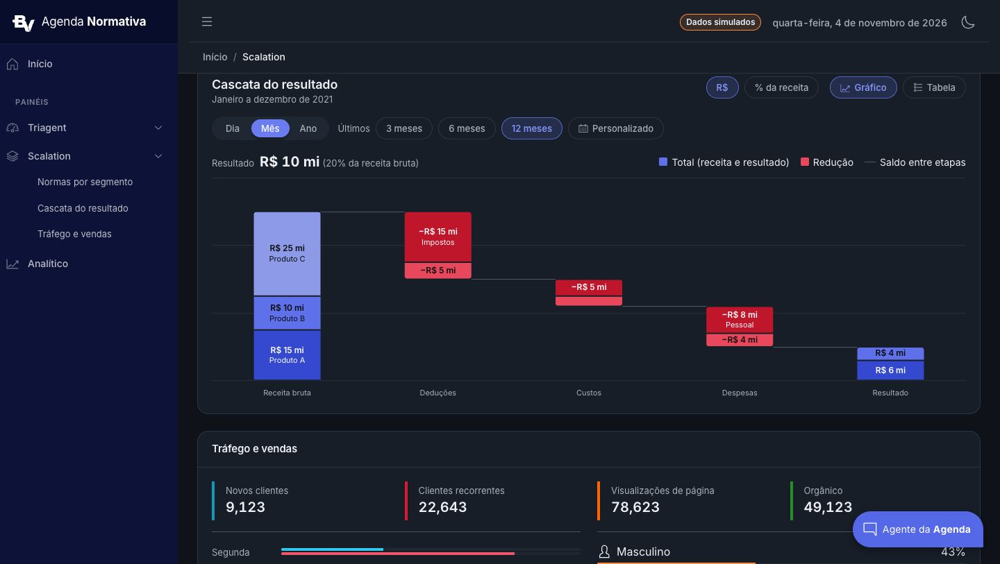
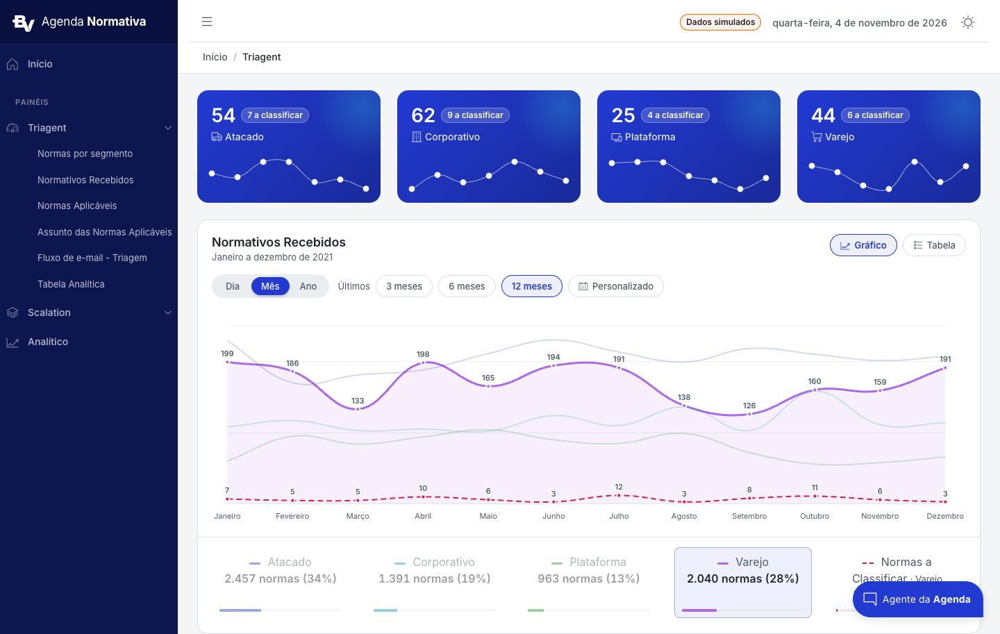
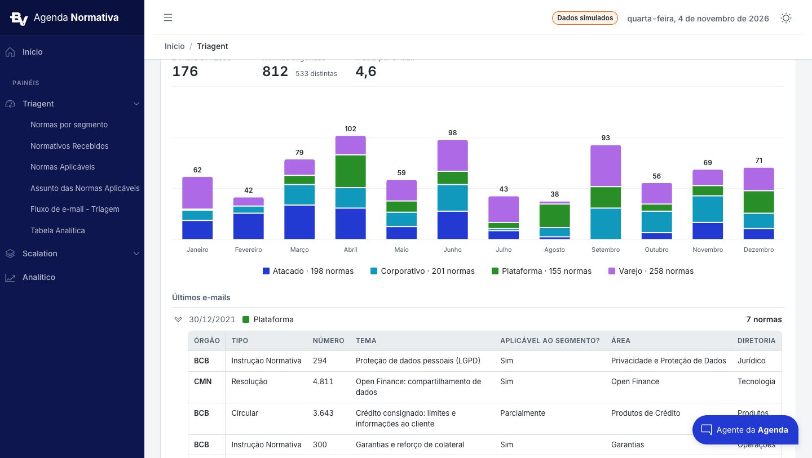
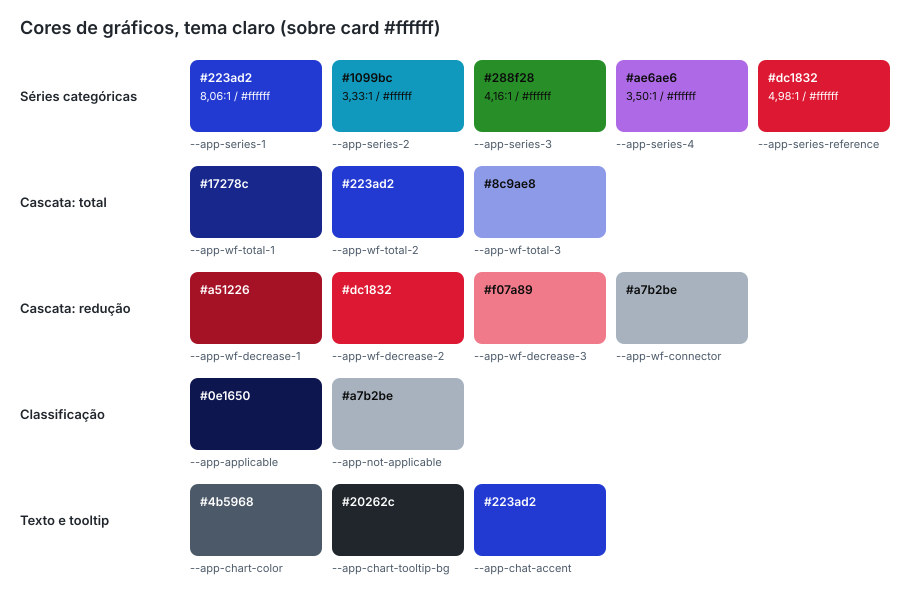

# 04. Gráficos

Como os gráficos da Agenda Normativa são construídos: regras de cor em canvas, defaults do Chart.js por tema, a
configuração exata de cada tipo (linha, minigráfico, cascata, barras empilhadas, rosca), os plugins próprios e a paleta
validada para daltonismo. Biblioteca: `chart.js` 3.9.x via `<c-chart>` de `@coreui/angular-chartjs` 4.4.x (API 3.x do
Chart.js: `drawBorder`, `ticks`, `Chart.defaults`; nada da 4.x).



## 1. Regras que valem para todo gráfico

1. **Canvas não lê CSS.** Toda cor, fonte e superfície é lida dos tokens na hora de montar o gráfico:
   - tokens globais: `getStyle('--app-series-1')` (`@coreui/utils`) ou `getComputedStyle(host).getPropertyValue(...)`;
   - cor do card: `--cui-card-bg` é definida em `.card`, então **não** existe no `document`. Leia a partir do próprio
     canvas (`chartSurfaceColor(context.chart.canvas)` em `dashboard-charts-data.ts`) ou de um `ElementRef` do card
     (`@ViewChild('card', { read: ElementRef, static: true })`).
2. **Troca de tema.** O `ThemeService` copia os tokens para `Chart.defaults` (texto, grade, fonte, tooltip) e chama
   `chart.update('none')`. Cada componente assina `themeService.appliedTheme$` com `takeUntil(destroy$)` e **remonta**
   `data` e `options` lendo os tokens de novo. Sempre crie objetos novos (o `c-chart` só redesenha quando a referência
   muda); nos gráficos de barra e rosca use também `[redraw]="true"`.
3. **Valores de reserva.** Toda leitura tem um valor de reserva igual ao valor claro de `_brand.scss`, para testes e
   canvas desanexado (`read('--app-chart-color', '#4b5968')`).
4. **Sem legenda do Chart.js.** `plugins.legend.display: false` em todos; a legenda é HTML (clicável, acessível,
   `03-componentes.md`, 8).
5. **Sem números no eixo Y.** `ticks.display: false` no Y; os valores são escritos por plugins (no ponto, dentro ou
   acima da barra). Grade só horizontal: `x.grid.display: false`; `y.grid` com `color: --app-chart-grid-color`,
   `drawBorder: false`, `drawTicks: false`.
6. **Eixo X.** Rótulos em `--app-chart-color`, fonte da marca 11 px, `maxRotation: 0`, `autoSkipPadding: 12` (o
   Chart.js pula rótulos quando não cabem, em vez de girar).
7. **Altura fixa e largura fluida.** `maintainAspectRatio: false` + `[height]` no `c-chart` (ou altura no contêiner);
   `c-chart { display: block; max-width: 100%; min-width: 0 }` (`_fixes.scss`).
8. **Tooltip.** Gráficos de linha usam o tooltip HTML do CoreUI (padrão do `c-chart`, `customTooltips = true`),
   estilizado por `.chartjs-tooltip` em `_charts.scss`. Barras e rosca usam o tooltip nativo (`[customTooltips]="false"`),
   que herda dos defaults do tema: fundo `--app-chart-tooltip-bg`, texto `--app-chart-tooltip-color`, `padding: 10`,
   `cornerRadius: 8`, título 600; chave da série com `usePointStyle` (`rect` para barras e fatias, `line` para a
   cascata).
9. **Acessibilidade.** Gráfico dentro de `<div role="img" [attr.aria-label]="resumo">` com um resumo textual dos números
   (ex.: "Gráfico de cascata, Janeiro a dezembro de 2021. Receita bruta R$ 50 mi; ...; Saldo final R$ 10 mi."), visão
   "Tabela" com os mesmos números e legenda em botões. O canvas do `c-chart` já tem `role="img"`; o conteúdo projetado
   (`<c-chart>Gráfico principal</c-chart>`) é o texto alternativo.
10. **Animação.** 400 ms em barras e rosca (`animation: { duration: 400 }`); padrão do Chart.js nas linhas.

Funções auxiliares (anexos):

| Função | Arquivo | O que faz |
|---|---|---|
| `withAlpha(hex, alpha)` | `chart-colors.ts.txt` | `#rrggbb` → `rgba(r, g, b, alpha)`; outros formatos voltam iguais |
| `hexToRgba(color, percent)` | `@coreui/utils` | Mesma ideia, com opacidade em porcentagem (usada na linha: 20 e 10) |
| `chartFontFamily()` | `dashboard-charts-data.ts.txt` | Lê `--app-chart-font-family` com reserva para a pilha do sistema |
| `chartSurfaceColor(canvas)` | `dashboard-charts-data.ts.txt` | Lê `--cui-card-bg` no canvas (reserva `#ffffff`) |
| `mix(cor, outra, quantidade)` | `waterfall-chart.component.ts.txt` | Mistura dois hex (hover da cascata: 20% de branco) |
| `inkFor(fundo)` | `waterfall-chart.component.ts.txt` | Escolhe `#ffffff` ou `#0b0b0b` pelo maior contraste WCAG com o preenchimento |

## 2. Linhas: "Normativos Recebidos"



Séries categóricas ao longo do tempo, com uma linha de referência tracejada, rótulos de valor em cada ponto e destaque
de série pela legenda. Anexos: `dashboard-charts-data.ts.txt`, `traffic-value-labels.plugin.ts.txt`,
`dashboard.component.*`.

```html
<c-chart *ngIf="view === 'chart'" [data]="mainChart.data" [height]="300" [ngStyle]="{ 'marginTop.px': 24 }"
  [options]="mainChart.options" [plugins]="[trafficValueLabelsPlugin]" [type]="'line'">Gráfico principal</c-chart>
```

Conjunto de dados por série (`TRAFFIC_SERIES`, na ordem da legenda: segmentos em ordem alfabética, referência por último):

```ts
{
  label: 'Atacado',
  data: values,
  borderColor: dimmed ? hexToRgba(color, 20) : color,       // demais séries a 20% quando uma está destacada
  backgroundColor: active ? hexToRgba(color, 10) : 'transparent',
  fill: active,                                               // área a 10% só na série destacada
  borderWidth: active ? 3 : 2,
  borderDash: series.dashed ? [8, 5] : [],                    // referência "Normas a Classificar"
  pointRadius: dimmed ? 0 : 3,
  pointHoverRadius: dimmed ? 0 : 5,
  pointBackgroundColor: color,
  pointBorderColor: (ctx) => chartSurfaceColor(ctx.chart.canvas),   // anel de 2 px na cor do card
  pointBorderWidth: 2,
  pointHoverBackgroundColor: color,
  pointHoverBorderColor: (ctx) => chartSurfaceColor(ctx.chart.canvas),
  pointHoverBorderWidth: 2,
  valueLabel: dimmed ? undefined : 'point'                    // lido pelo plugin de rótulos
}
```

Opções:

```ts
{
  maintainAspectRatio: false,
  layout: { padding: { top: 16, left: 12, right: 16 } },      // espaço para os rótulos nas pontas
  plugins: {
    legend: { display: false },
    tooltip: { callbacks: { labelColor: (ctx) => ({ backgroundColor: ctx.dataset.pointBackgroundColor }) } }
  },
  scales: {
    x: {
      grid: { display: false, drawBorder: false },
      ticks: { color: getStyle('--app-chart-color'), font: { family: chartFontFamily(), size: 11 }, maxRotation: 0, autoSkipPadding: 12 }
    },
    y: {
      beginAtZero: true,
      max: 250,                                               // teto fixo do domínio da origem; ajuste ao dado
      grid: { color: getStyle('--app-chart-grid-color'), drawTicks: false, drawBorder: false },
      ticks: { display: false, maxTicksLimit: 5, stepSize: Math.ceil(250 / 5) }
    }
  },
  elements: {
    line: { tension: 0.4, borderWidth: 2 },
    point: { radius: 0, hitRadius: 10, hoverRadius: 5, hoverBorderWidth: 2 }
  }
}
```

Plugin de rótulos de valor (`trafficValueLabelsPlugin`, `afterDatasetsDraw`):

- Escreve o valor de cada ponto acima dele (6 px), formatado com `Intl.NumberFormat('pt-BR')`.
- Fonte `600 11px` na família da marca; tinta `--app-chart-color`; halo de 3 px (`strokeText`, `lineJoin: round`) na cor
  do card (`--cui-card-bg`), lido do canvas a cada desenho, então acompanha o tema sem remontar.
- Rótulos no mesmo X são empilhados de cima para baixo com 13 px de distância mínima (nunca se sobrepõem).
- Em séries densas, rotula um ponto a cada `ceil(30 px / espaçamento)` (o tooltip cobre o resto).
- Só rotula conjuntos com `valueLabel: 'point'` e visíveis (as séries esmaecidas ficam sem rótulo).

Comportamento de destaque: clicar num item da legenda destaca a série (3 px, área a 10%, pontos e rótulos); as demais
ficam a 20% sem pontos nem rótulos; a linha de referência continua ativa quando o destaque é um segmento (e passa a
mostrar só as pendências daquele segmento, com o rótulo "Normas a Classificar · Atacado").

## 3. Minigráfico (cards de segmento)

Linha branca sobre o degradê do card. Anexo: `widgets-dropdown.component.ts.txt`.

```ts
// canvas não lê CSS: branco a partir do token do CoreUI
const WHITE = `rgb(${getStyle('--cui-white-rgb') || '255, 255, 255'})`;
const LINE = `rgba(${getStyle('--cui-white-rgb') || '255, 255, 255'}, .6)`;

dataset = { label: 'Normas · Atacado', backgroundColor: 'transparent', borderColor: LINE,
            pointBackgroundColor: WHITE, pointHoverBorderColor: WHITE, data: trend };

options = {
  plugins: { legend: { display: false } },
  maintainAspectRatio: false,
  scales: {
    x: { grid: { display: false, drawBorder: false }, ticks: { display: false } },
    y: { min, max, display: false, grid: { display: false }, ticks: { display: false } }
  },
  elements: { line: { borderWidth: 1, tension: 0.4 }, point: { radius: 4, hitRadius: 10, hoverRadius: 4 } }
};
// faixa vertical por card, com folga para a linha e os pontos não encostarem nas bordas
const range = (max - min) || 1;
options.scales.y.min = Math.floor(min - range * 0.3);
options.scales.y.max = Math.ceil(max + range * 0.15);
```

`<c-chart class="brand-stat-chart" height="70" type="line">`, margem `.75rem 1rem 0`. Tooltip HTML padrão do `c-chart`.

## 4. Cascata: "Cascata do resultado"

Barras flutuantes empilhadas: cada etapa é "total" (sobe do zero) ou "redução" (desce do saldo anterior) e tem de 1 a 3
componentes; linhas finas ligam o saldo de uma etapa à próxima. Anexos: `waterfall-chart.component.*`,
`waterfall.model.ts.txt` (`buildWaterfall`), `waterfall-format.ts.txt`.

Modelo: cada componente vira um conjunto de dados com valor só na sua coluna, no formato `[baixo, alto]`:

```ts
datasets: model.segments.map((segment) => ({
  label: segment.partLabel,
  data: labels.map((_, i) => (i === segment.stepIndex ? [segment.low, segment.high] : null)),
  backgroundColor: color,                                   // rampa total ou redução, passo = índice do componente
  hoverBackgroundColor: mix(color, '#ffffff', 0.2),         // hover clareia 20%
  borderColor: surface, hoverBorderColor: surface,          // 1 px em cima e embaixo na cor do card = 2 px de vão
  borderWidth: { top: 1, bottom: 1, left: 0, right: 0 },
  borderSkipped: false,
  borderRadius: (ctx) => segmentRadius(ctx.datasetIndex),   // 4 px só nas pontas externas da coluna
  grouped: false,
  skipNull: true,
  barPercentage: 0.6,
  categoryPercentage: 1,
  maxBarThickness: 96
}))
```

Opções:

```ts
{
  maintainAspectRatio: false,
  animation: { duration: 400 },
  interaction: { mode: 'nearest', intersect: true },        // o alvo é o componente sob o cursor
  hover: { mode: 'nearest', intersect: true },
  plugins: {
    legend: { display: false },
    tooltip: {
      mode: 'nearest', intersect: true, usePointStyle: true,
      // código completo em waterfall-chart.component.ts.txt; exemplos de saída nos comentários
      callbacks: {
        title: (items) => signedValue(segmentOf(items[0])),              // "−R$ 15 mi"
        label: (item) => `${segment.partLabel} · ${segment.stepLabel}`,  // "Impostos · Deduções"
        afterLabel: (item) => [share, `Saldo após ${step}: ${saldo}`],    // ["30% da receita bruta", "Saldo após Deduções: R$ 35 mi"]
        labelPointStyle: () => ({ pointStyle: 'line', rotation: 0 }),
        labelColor: (item) => ({ borderColor: color, backgroundColor: color, borderWidth: 2 })  // chave em linha na cor do componente
      }
    }
  },
  scales: {
    x: { grid: { display: false, drawBorder: false }, ticks: { color: axisText, font: { family, size: 11 }, maxRotation: 0 } },
    y: {
      beginAtZero: true,
      suggestedMax: unit === 'percent' ? undefined : base * 1.08,   // R$: 8% de folga acima da receita
      max: unit === 'percent' ? base : undefined,                    // %: eixo termina em 100% da receita
      grid: { color: grid, drawBorder: false, drawTicks: false },
      ticks: { display: false, maxTicksLimit: 6, stepSize: unit === 'percent' ? base / 5 : undefined }
    }
  }
}
```

| Detalhe | Valor |
|---|---|
| Cores | Componente `i` de uma etapa total usa `--app-wf-total-i`; de uma redução, `--app-wf-decrease-i` (do mais escuro para o mais claro). Legenda usa o passo 2 de cada rampa |
| Raio | 4 px: no total, só o topo do último componente (a base fica reta no zero); na redução, topo do primeiro e base do último |
| Conectores (plugin `waterfallConnectors`) | Linha de 1 px em `--app-wf-connector`, da borda direita de uma coluna à borda esquerda da próxima, na altura do saldo (`Math.round(y) + 0.5` para ficar nítida) |
| Rótulos (plugin `waterfallLabels`) | Dentro do componente, centralizados: valor `600 12px` + nome `400 11px` se a barra tiver ≥ 36 px de altura e o texto couber com 8 px de folga de cada lado; só o valor se tiver ≥ 18 px; senão nada (tooltip e tabela cobrem). Tinta por `inkFor()` (branco ou `#0b0b0b`) |
| Unidades | Chips "R$" (moeda compacta: "R$ 15 mi", sinal de menos tipográfico "−") e "% da receita" (participação sobre a primeira etapa total, até 1 casa) |
| Altura | 320 px (`.waterfall-chart { position: relative; height: 320px }`) |
| Resumo acessível | `role="img"` + `aria-label` com cada etapa, valor e saldo final |
| Validação do modelo | Lança erro se não houver etapas, se uma etapa tiver 0 ou mais de 3 componentes (`MAX_PARTS_PER_STEP = 3`, igual ao número de passos das rampas) ou valor negativo/inválido; o card mostra o estado de erro |

## 5. Barras empilhadas: "Fluxo de e-mail - Triagem"



Uma barra por período, empilhando os segmentos com as mesmas cores do gráfico de linhas; total escrito acima.
Anexo: `emails-chart.component.*`.

```ts
datasets: positions.map((position, order) => ({
  label: 'Atacado',
  data: buckets.map((b) => b.normas[position]),
  backgroundColor: dimmed ? withAlpha(color, 0.28) : color,  // destaque pela legenda: demais a 28%
  hoverBackgroundColor: fill,
  borderColor: surface, hoverBorderColor: surface,           // 2 px de vão entre segmentos
  borderWidth: { top: 1, bottom: 1, left: 0, right: 0 },
  borderSkipped: false,
  borderRadius: (ctx) => ({ topLeft: r, topRight: r, bottomLeft: 0, bottomRight: 0 }),  // r = 4 só no segmento do topo da pilha
  barPercentage: 0.7,
  categoryPercentage: 0.85,
  maxBarThickness: 56
}))

options = {
  maintainAspectRatio: false,
  animation: { duration: 400 },
  interaction: { mode: 'index', intersect: false },          // tooltip da coluna inteira
  plugins: {
    legend: { display: false },
    tooltip: {
      usePointStyle: true,
      filter: (item) => (item.parsed.y ?? 0) > 0,             // esconde segmentos zerados
      // código completo em emails-chart.component.ts.txt; exemplos de saída nos comentários
      callbacks: {
        title: (items) => buckets[items[0].dataIndex].label,               // "Março"
        beforeBody: (items) => countLabel(bucket.emails, 'e-mail', 'e-mails'),   // "14 e-mails"
        label: (item) => `${item.dataset.label}: ${countLabel(item.parsed.y, 'norma', 'normas')}`,  // "Atacado: 21 normas"
        footer: (items) => `Total: ${countLabel(bucket.total, 'norma', 'normas')}`,  // só com mais de um segmento
        labelPointStyle: () => ({ pointStyle: 'rect', rotation: 0 }),
        labelColor: (item) => ({ borderColor: color, backgroundColor: color, borderWidth: 0, borderRadius: 2 })
      }
    }
  },
  scales: {
    x: { stacked: true, grid: { display: false, drawBorder: false },
         ticks: { color: axisText, font: { family, size: 11 }, maxRotation: 0, autoSkip: true, autoSkipPadding: 12 } },
    y: { stacked: true, beginAtZero: true, suggestedMax: Math.ceil(peak * 1.18),   // folga para o total
         grid: { color: grid, drawBorder: false, drawTicks: false }, ticks: { display: false, maxTicksLimit: 5, precision: 0 } }
  }
};
```

Plugin `emailsTotalLabels`: total da pilha 5 px acima do segmento mais alto, `600 12px`, cor `--brand-content-high`; omitido
se o texto (+ 4 px) não couber na largura da coluna (ex.: 92 dias). Altura 300 px. Contagens no plural certo
("1 norma", "2 normas").

## 6. Rosca: "Normas Aplicáveis"

Duas fatias (aplicáveis / não aplicáveis) com o total no centro e legenda clicável. Anexo:
`applicability-chart.component.*`, estilos em `_classification-card.scss`.

```html
<div class="applicability-chart" role="img" [attr.aria-label]="ariaSummary" data-page-filter>   <!-- position: relative; height: 220px -->
  <c-chart type="doughnut" [data]="chartData" [options]="chartOptions" [redraw]="true" [customTooltips]="false" [height]="220"></c-chart>
  <div class="applicability-center" aria-hidden="true">                                       <!-- absolute, inset 0, centralizado, sem eventos -->
    <strong>573</strong><span>classificadas</span>
  </div>
</div>
```

```ts
data = { labels: ['Aplicáveis', 'Não aplicáveis'], datasets: [{
  data: [aplicaveis, naoAplicaveis],
  backgroundColor: fills, hoverBackgroundColor: fills,        // --app-applicable, --app-not-applicable; não escolhida a 16%
  borderColor: surface, hoverBorderColor: surface, borderWidth: 2   // 2 px de vão na cor do card
}]};
options = {
  maintainAspectRatio: false,
  cutout: '62%',
  layout: { padding: 10 },                                    // espaço para a fatia deslocada
  elements: { arc: { offset: (ctx) => (escolhida(ctx.dataIndex) ? 10 : 0) } },
  animation: { duration: 400 },
  onClick: (_e, elements) => elements.length && select(slices[elements[0].index]),
  onHover: (e, elements) => (e.native.target.style.cursor = elements.length ? 'pointer' : 'default'),
  plugins: {
    legend: { display: false },
    tooltip: { usePointStyle: true, callbacks: {
      label: (item) => 'Aplicáveis: 368 (64%)',
      labelPointStyle: () => ({ pointStyle: 'rect', rotation: 0 })
    } }
  }
};
```

Fatia escolhida (pela fatia ou pela legenda) sai 10 px do anel; a outra fica a 16% (a 28% o azul-marinho esmaecido se
confundia com o cinza). Centro: total 28 px 600 tabular + "classificadas" 13 px.

## 7. Barras em HTML

Rankings longos (temas) não usam canvas: são linhas em grade com barra em CSS, rótulo truncado com `title`, valor e
percentual sempre escritos. Ver `03-componentes.md`, 12. Vantagens: texto selecionável, foco e clique por linha, tema
escuro automático.

## 8. Paleta de gráficos



### 8.1 Por que não as cores puras da marca

As cores puras foram feitas para marca e botões, não para séries lado a lado. Com a sequência pura (`#223ad2, #31c7ed,
#36bf36, #ae6ae6, #dc1832`) sobre branco, o ciano puro fica fora da faixa de luminosidade (OKLCH L 0,771 > 0,77) e tem
2,00:1 de contraste; o verde puro tem 2,42:1; o validador reprova. Por isso as séries usam as variantes escuras da mesma
família (`#1099bc`, `#288f28`) e o tema escuro usa variantes deslocadas para a superfície `#171e28`.

### 8.2 Séries categóricas (ordem fixa)

| Posição | Série na origem | Token | Claro (sobre `#ffffff`) | Escuro (sobre `#171e28`) |
|---|---|---|---|---|
| 1 | Atacado | `--app-series-1` | `#223ad2` (8,06:1) | `#4d61e0` (3,27:1) |
| 2 | Corporativo | `--app-series-2` | `#1099bc` (3,33:1) | `#1099bc` (5,03:1) |
| 3 | Plataforma | `--app-series-3` | `#288f28` (4,16:1) | `#2fae2f` (5,76:1) |
| 4 | Varejo | `--app-series-4` | `#ae6ae6` (3,50:1) | `#ae6ae6` (4,79:1) |
| 5 | Referência ("Normas a Classificar") | `--app-series-reference` | `#dc1832` (4,98:1), tracejada `[8, 5]` | `#e8475c` (4,38:1), tracejada |

Codificação além da cor: referência tracejada; rótulo de valor em cada ponto; legenda com total e participação; anel
na cor do card em cada ponto. Os mesmos tokens 1 a 4 colorem as barras empilhadas, as chaves das listas e as colunas
das tabelas.

Resultado da validação na origem (2026-10-28, pares adjacentes na ordem da legenda):

| Tema | Pior par adjacente (daltonismo) | Pior par (visão normal) | Faixa de L | Croma | Contraste ≥ 3:1 | Resultado |
|---|---|---|---|---|---|---|
| Claro, `#ffffff` | `#288f28` ↔ `#1099bc`, ΔE 18,4 (deutan); tritan 8,5 | ΔE 19,5 | 5/5 em 0,43–0,77 | 5/5 ≥ 0,10 | 5/5 | Aprovado |
| Escuro, `#171e28` | `#1099bc` ↔ `#4d61e0`, ΔE 14,3 (deutan); tritan 3,1 | ΔE 17,0 | 5/5 em 0,48–0,67 | 5/5 ≥ 0,10 | 5/5 | Aprovado |

O valor tritan só é informativo; no escuro ele é baixo entre azul e ciano, compensado pelo tracejado e pelos rótulos.

### 8.3 Rampas ordinais da cascata

| Rampa | Tema | Passos (escuro → claro) | L monótona | ΔL vizinho ≥ 0,06 | Extremo vs superfície (≥ 2:1) | Matiz (≤ 40°) |
|---|---|---|---|---|---|---|
| Total | Claro | `#17278c`, `#223ad2`, `#8c9ae8` | sim | sim | `#8c9ae8` 2,66:1 | 8° |
| Redução | Claro | `#a51226`, `#dc1832`, `#f07a89` | sim | sim | `#f07a89` 2,68:1 | 10° |
| Total | Escuro | `#3448d0`, `#5f71ea`, `#8c9ae8` | sim | sim | `#3448d0` 2,38:1 | 6° |
| Redução | Escuro | `#c0162c`, `#e8475c`, `#f59aa6` | sim | sim | `#c0162c` 2,71:1 | 12° |

Os extremos ficam abaixo de 3:1 por natureza de rampa; a cascata compensa com rótulos sobre as barras, tooltip por
componente e visão "Tabela". Conector: `#a7b2be` (claro) e `#4b5968` (escuro).

### 8.4 Classificação binária

`--app-applicable` (`#0e1650` claro, `#a4b0f2` escuro) e `--app-not-applicable` (`#a7b2be` claro, `#4b5968` escuro):
azul-marinho fora da família dos azuis das séries, para não ser lido como "Atacado", contra cinza neutro. Valores sempre
escritos ao lado.

### 8.5 Não reordenar

A validação é feita sobre **pares adjacentes na ordem da legenda**. Trocar a ordem, trocar uma cor de posição ou inserir
série no meio invalida o resultado. Série nova entra no fim e passa pela validação; rampa nova é validada inteira, por
tema. Valores escuros (`_theme-dark.scss`) e reservas em TypeScript mudam junto.

## 9. Como validar uma paleta nova

Na origem foi usado o validador `validate_palette.js` do skill `dataviz` (não está no repositório):

```bash
node validate_palette.js "#223ad2,#1099bc,#288f28,#ae6ae6,#dc1832" --mode light --surface "#ffffff"
node validate_palette.js "#4d61e0,#1099bc,#2fae2f,#ae6ae6,#e8475c" --mode dark  --surface "#171e28"
node validate_palette.js "#17278c,#223ad2,#8c9ae8" --ordinal --mode light --surface "#ffffff"
node validate_palette.js "#a51226,#dc1832,#f07a89" --ordinal --mode light --surface "#ffffff"
node validate_palette.js "#3448d0,#5f71ea,#8c9ae8" --ordinal --mode dark  --surface "#171e28"
node validate_palette.js "#c0162c,#e8475c,#f59aa6" --ordinal --mode dark  --surface "#171e28"
```

Sem o script, os critérios são todos calculáveis a partir dos hex (Node, Python ou planilha):

1. sRGB → linear (`c ≤ 0,04045 ? c/12,92 : ((c+0,055)/1,055)^2,4`) → OKLab (matrizes de Björn Ottosson) → OKLCH
   (`L`, `C = hypot(a, b)`, `h = atan2(b, a)`).
2. **Luminosidade (categórico):** `L` em [0,43; 0,77] no claro e [0,48; 0,67] no escuro.
3. **Croma (categórico):** `C ≥ 0,10`.
4. **Daltonismo (categórico):** simular protanopia e deuteranopia (Machado, Oliveira e Fernandes, 2009, severidade 1,0,
   em RGB linear), converter para OKLab, ΔE = distância euclidiana × 100; por par adjacente, o mínimo entre protan e
   deutan. ≥ 8,0 aprovado; 6,0–8,0 alerta (só com codificação secundária); < 6,0 reprovado. Tritan só se reporta.
5. **Visão normal:** ΔE sem simulação ≥ 15,0 no pior par adjacente; abaixo, reprovado.
6. **Contraste com a superfície:** WCAG 2.x `(L1 + 0,05) / (L2 + 0,05)`, luminância `0,2126 R + 0,7152 G + 0,0722 B` em
   RGB linear; alvo ≥ 3:1 contra o card claro e o escuro; abaixo, exige codificação secundária.
7. **Rampas ordinais:** `L` estritamente monótona; `|ΔL| ≥ 0,06` entre vizinhos; extremo mais próximo da superfície com
   ≥ 2:1; dispersão de matiz ≤ 40°.
8. Repetir nos dois temas e registrar os números no design system do projeto, com a data.

## 10. Checklist para um gráfico novo

- [ ] Cores lidas de `--app-*` na montagem, com reserva igual ao valor claro; nenhuma cor fixa no componente.
- [ ] Remonta em `appliedTheme$` (objetos novos; `[redraw]="true"` em barras e rosca).
- [ ] `legend.display: false` e legenda HTML com botões, `aria-pressed` e estados (8.1 de `03-componentes.md`).
- [ ] Sem números no eixo Y; valores escritos por plugin quando couberem; tooltip com texto completo.
- [ ] Grade só horizontal, `drawBorder: false`; eixo X 11 px sem rotação.
- [ ] `maintainAspectRatio: false` com altura fixa; encolhe até 375 px sem rolagem horizontal.
- [ ] `role="img"` + `aria-label` com o resumo; visão "Tabela" com os mesmos números (e "Exportar Excel", se fizer sentido).
- [ ] Estados de carregando, erro e vazio (`03-componentes.md`, 13).
- [ ] Paleta nova validada nos dois temas (seção 9); séries existentes na ordem da legenda.
- [ ] Números e datas formatados em pt-BR (`05-conteudo-e-acessibilidade.md`).
