# 06. Telas

Composição de cada tela da Agenda Normativa, com capturas (Chrome headless sobre o build de produção da landing em
modo de demonstração, 2026-11-04, dados de demonstração que mudam a cada carga; rodapé só com a marca e o copyright).
Larguras: 1440 px (desktop) e 375 px (celular). O selo "Dados simulados" no header aparece porque as capturas usam o
modo de demonstração; com dados reais ele não é exibido.

## 1. Rotas

| Rota | Título no breadcrumb | Pasta de código na origem | Conteúdo |
|---|---|---|---|
| `/` | (vazio: só "Início" na trilha) | `views/home` | Quatro cards de segmento (normas e a classificar) |
| `/triagent` | Triagent | `views/dashboard` | Painel principal: segmentos, linhas, rosca, temas, e-mails, tabela analítica |
| `/scalation` | Scalation | `views/scalation` | Segmentos (tom petróleo), cascata, bloco de demonstração |
| `/analitico` | Analítico | `views/analytics` | Vazio (conteúdo a definir) |
| `/dashboard` | — | — | Redireciona para `/triagent` (endereço antigo) |
| qualquer outra | — | — | Redireciona para `/` |

Rotas limpas (sem `#/`); a seção vai no fragmento, como em `/triagent#tabela-analitica`.

Todas as páginas são módulos carregados sob demanda (`loadChildren`) dentro do `DefaultLayoutComponent`.

## 2. Casca: header, menu e seletor de tema

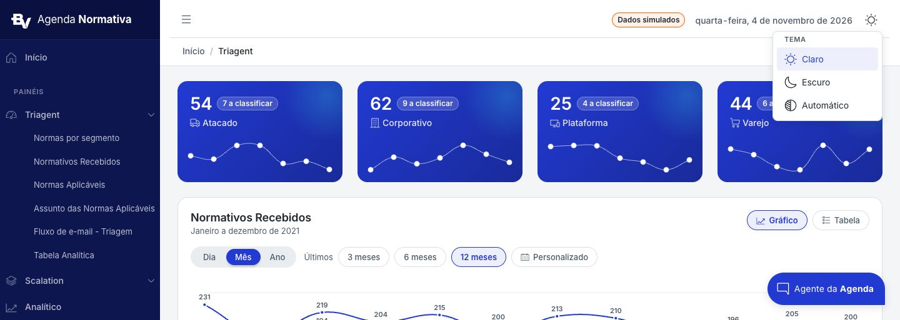

Menu azul-marinho com a marca no topo, título "PAINÉIS", grupo aberto com fundo mais escuro e subitens de seção. Header
branco com o botão do menu à esquerda, data por extenso e seletor de tema à direita, e a trilha de navegação na segunda
linha. Detalhes em `02-tipografia-e-layout.md`, 3.

## 3. Triagent (`/triagent`)

### 3.1 Tema claro

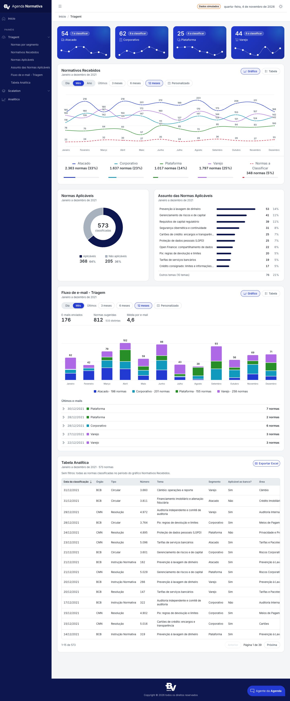

### 3.2 Tema escuro

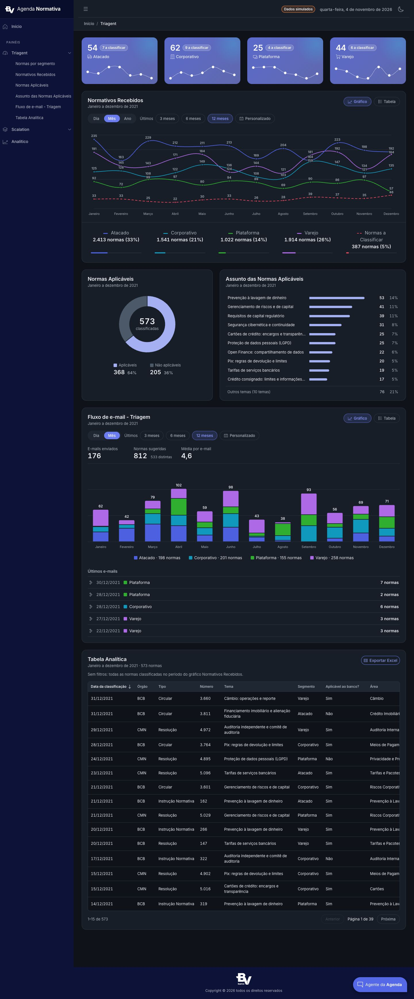

### 3.3 Composição (de cima para baixo)

| # | Bloco | `id` (subitem do menu) | Grade | Componente |
|---|---|---|---|---|
| 1 | Cards de segmento | `segmentos` | 4 colunas (`sm="6" xl="3"`) | `.brand-stat-card` tom azul, selo clicável (`03-componentes.md`, 2) |
| 2 | Faixa "Filtro: normas a classificar · X" | — | largura total | só com filtro de segmento ligado |
| 3 | Normativos Recebidos | `normativos-recebidos` | largura total | Cabeçalho (título + período · chips Gráfico/Tabela + "Exportar Excel" na visão Tabela), filtro de período, gráfico de linhas 300 px ou tabela, legenda clicável no rodapé do card (5 colunas) |
| 4 | Faixa "Filtro: Aplicáveis · Tema: X" | — | largura total | só com filtro cruzado ligado |
| 5 | Normas Aplicáveis + Assunto das Normas Aplicáveis | `normas-aplicaveis`, `assunto-das-normas` | `lg="5"` + `lg="7"`, `g-4`, mesma altura | Rosca com total no centro + legenda clicável; ranking de temas em barras HTML com "Outros temas". Sem filtro de período próprio: seguem o período do bloco 3 |
| 6 | Fluxo de e-mail - Triagem | `fluxo-de-email` | largura total | Chips Gráfico/Tabela + exportar, filtro de período (Dia/Mês), indicadores, barras empilhadas 300 px ou tabela, legenda clicável, lista "Últimos e-mails" expansível |
| 7 | Tabela Analítica | `tabela-analitica` | largura total | Filtros aplicados, tabela ordenável e paginada (15 por página), exportar, pergunta ao chat por linha |

Filtros que atravessam a página: o selo "N a classificar" de um card filtra os blocos 3, 5, 6 e 7 por segmento; um
clique numa fatia/legenda da rosca filtra os temas, e um tema filtra a rosca; os dois se refletem na tabela. `Esc` ou
clique fora remove; clicar de novo desliga.

### 3.4 Estados

Filtro de segmento ligado (card ativo com anel ciano, demais a 50%, faixa de filtro, linha de pendências do segmento):

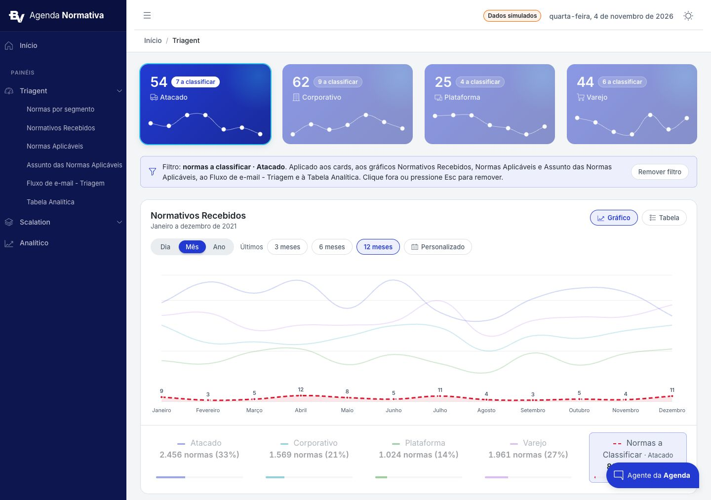

Série destacada pela legenda (demais a 20%, área sob a destacada):

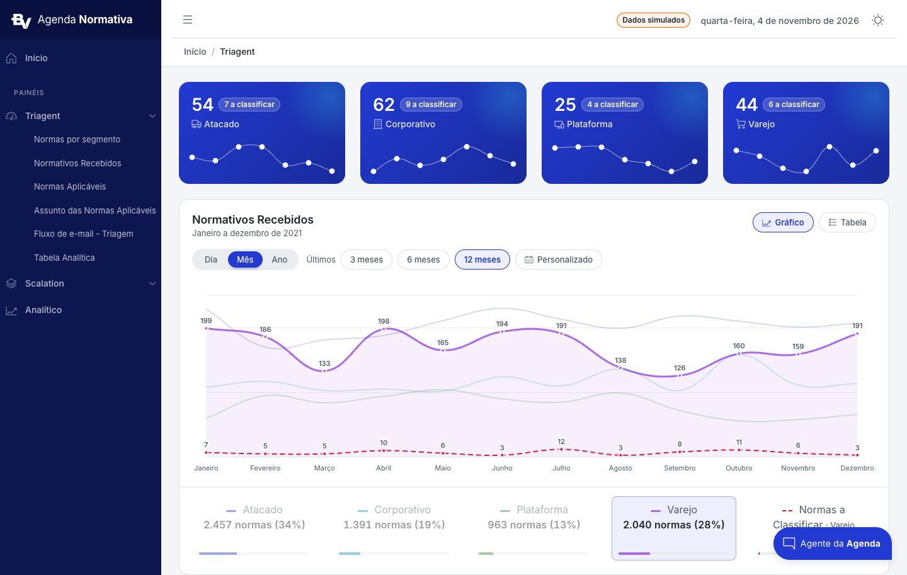

Visão Tabela com "Exportar Excel":

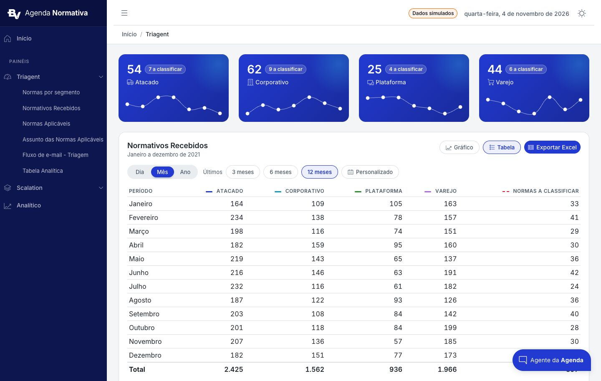

Intervalo personalizado aberto:

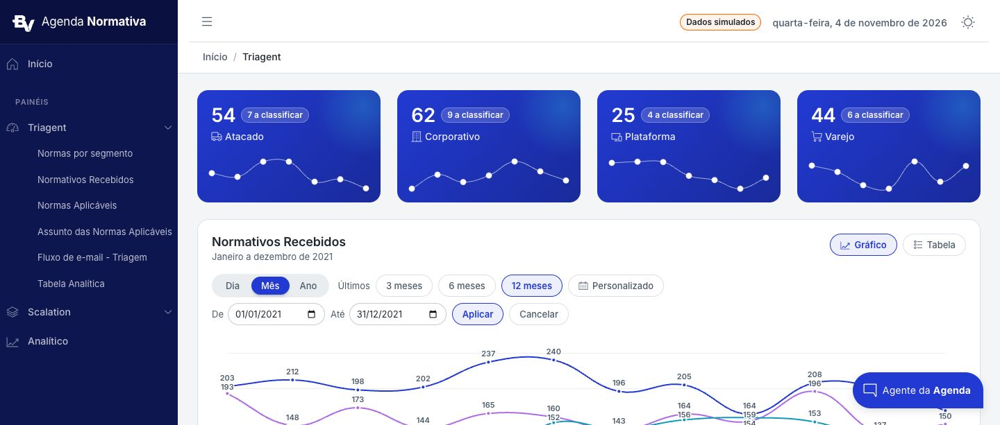

Filtro cruzado (tema escolhido na lista; rosca recalculada para o tema):

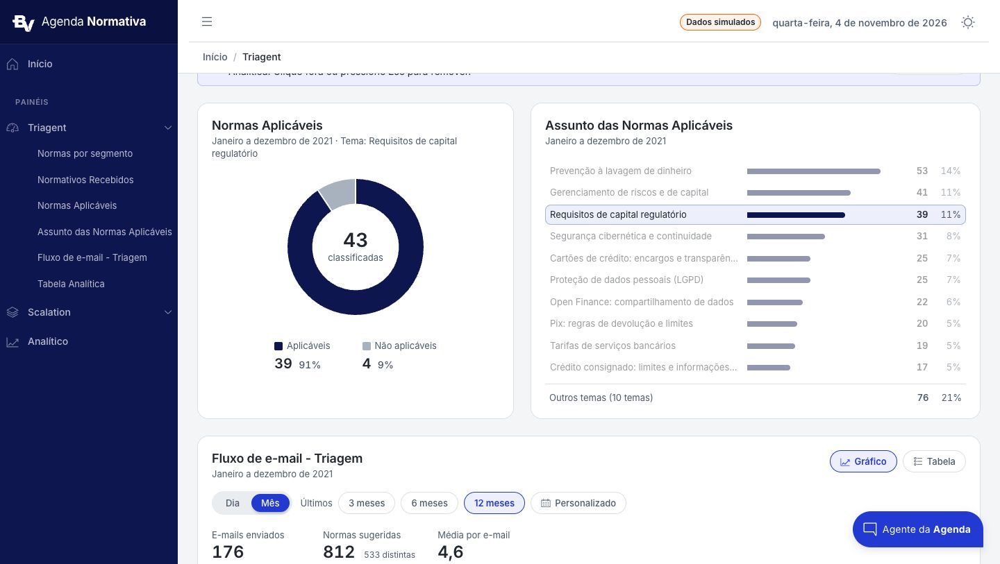

Item da lista de e-mails expandido (tabela aninhada com coluna fixa):

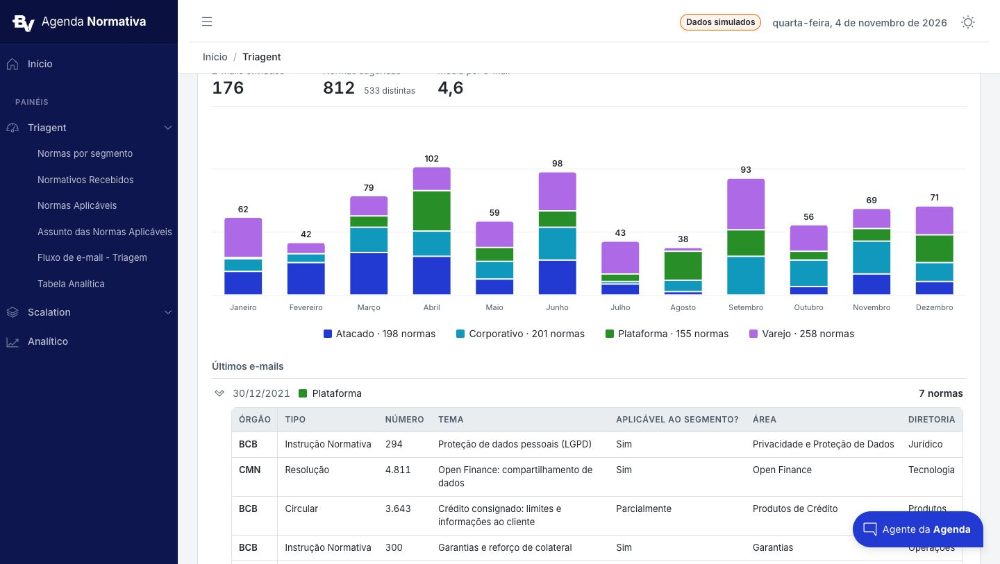

### 3.5 Celular (375 px)

Menu escondido, cards empilhados, legenda em uma coluna, ranking com o nome acima da barra, tabelas rolando dentro do
card. Captura em `02-tipografia-e-layout.md`, 8 (`imagens/triagent-claro-375.jpg`).

## 4. Scalation (`/scalation`)

### 4.1 Tema claro

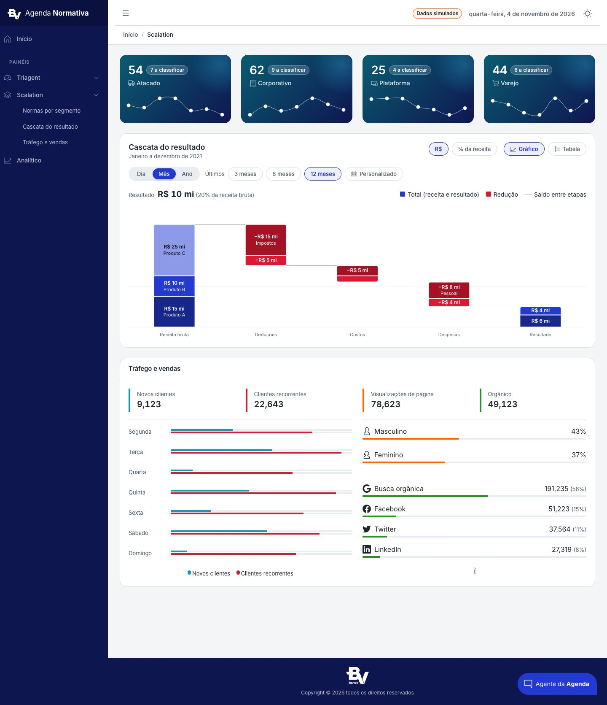

### 4.2 Tema escuro

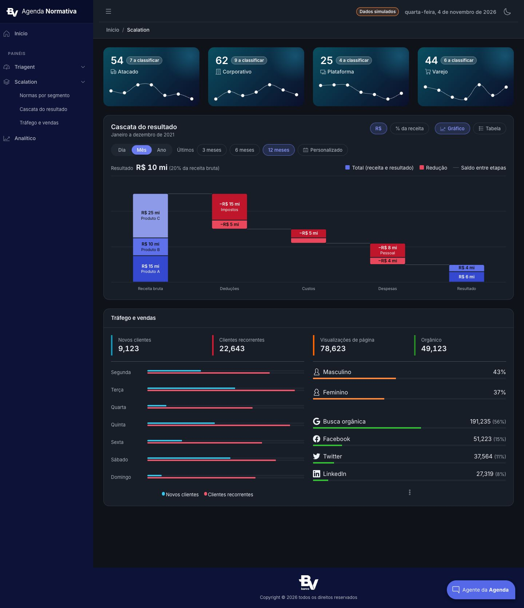

### 4.3 Composição

| # | Bloco | `id` | Componente |
|---|---|---|---|
| 1 | Cards de segmento | `segmentos` | `.brand-stat-card` com `tone="petrol"` e `[filterable]="false"` (selo só texto) |
| 2 | Cascata do resultado | `cascata` | Cabeçalho (título + período · chips R$ / % da receita e Gráfico / Tabela), filtro de período, linha "Resultado" + legenda estática, cascata 320 px ou tabela agrupada por etapa |
| 3 | Tráfego e vendas | `trafego-e-vendas` | Bloco de demonstração herdado do template (não faz parte da identidade; `03-componentes.md`, 16) |

O tom petróleo dos cards diferencia visualmente o segundo painel sem criar cor nova (usa `--brand-highlight-high` →
`--brand-sidebar`).

## 5. Início (`/`)

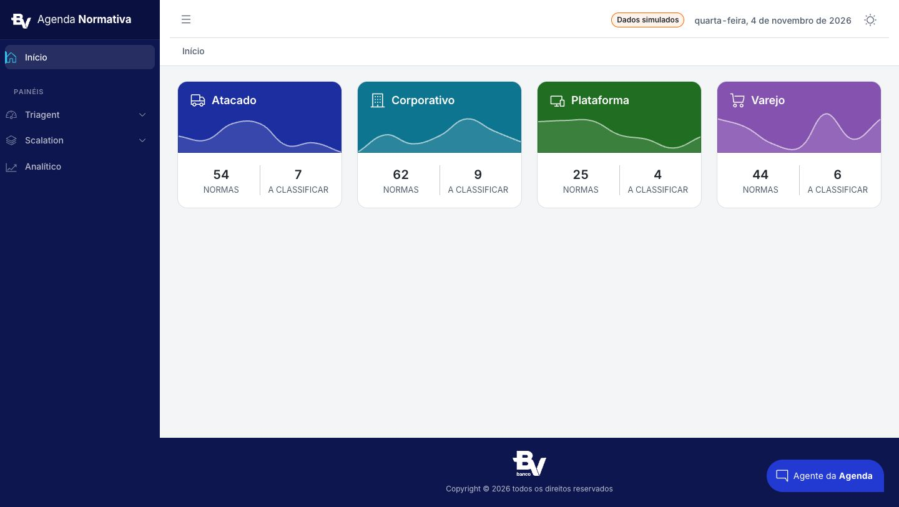

Mostra os quatro cards de segmento (Atacado, Corporativo, Plataforma, Varejo), cada um com faixa colorida, ícone,
minigráfico e os totais de normas e de normas a classificar.

## 6. Analítico (`/analitico`)

Página vazia com `<h1 class="visually-hidden">Analítico</h1>`, à espera de conteúdo. Nova página segue o mesmo padrão:
módulo próprio em `views/<pasta>`, rota com `data.title`, item no `_nav.ts`, `h1` oculto, blocos em cards com `id`.
