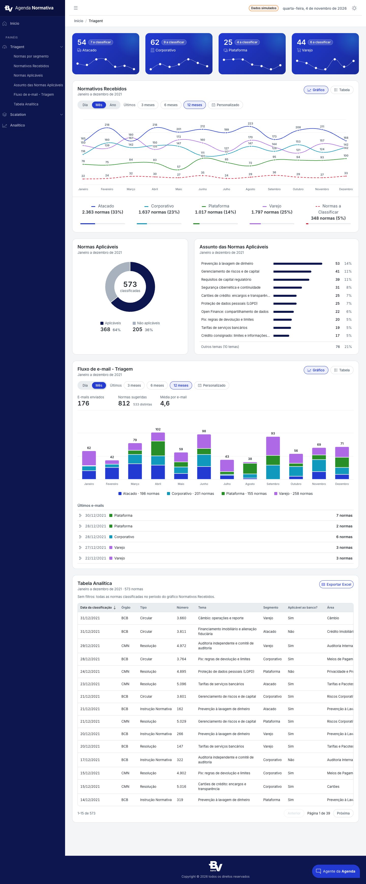

# Referência visual: Agenda Normativa

Retrato da interface do painel **Agenda Normativa** (projeto `landing-analitica`), guardado neste template para que
outra landing page reproduza a mesma linguagem visual (marca, cores, fontes, componentes, gráficos, estados,
acessibilidade e textos) sem depender do projeto de origem e **dentro das mesmas especificações técnicas** (Angular 15,
CoreUI 4, Node 18; seção 2).

> **Histórico (2026-11-03):** este retrato é de 2026-10-28, antes da migração para Node 22, Angular 20.3 e CoreUI 5.5. Cores,
> fonte, componentes e telas continuam valendo (a landing migrada mede igual); os `anexos/` têm SCSS e TypeScript da época
> (`@import`, NgModules, Chart.js 3). Ao aplicar, use as versões atuais desses arquivos na `landing-analitica` ou reescreva
> no idioma da R3 deste template; ver ADR-021 da landing e ADR-004 daqui.

| Item | Valor |
|---|---|
| Origem | `landing-analitica` (pasta irmã deste template), estado de 2026-10-28 |
| Carimbo dos tokens na origem | `tokens-hash: d691d9775392` (SHA-1 de `_brand.scss` + `_variables.scss` + `_theme-dark.scss`, 12 primeiros caracteres) |
| Capturas | Refeitas em 2026-11-04: Chrome headless sobre o build de produção da landing em modo de demonstração, rotas limpas, 1440 px e 375 px, temas claro e escuro; dados de demonstração (os valores mudam a cada carga); rodapé só com a marca e o copyright |
| Situação no template | Só documentação e anexos. Nada desta pasta é compilado, importado ou servido pelo template: o visual do template continua o padrão do CoreUI até alguém aplicar a receita de [`07-aplicacao.md`](07-aplicacao.md) |

## 1. Como usar esta pasta

- **Pessoa:** comece pelas capturas de [`06-telas.md`](06-telas.md) para ver o resultado, depois leia
  [`07-aplicacao.md`](07-aplicacao.md) (receita) e consulte os demais documentos por assunto.
- **IA (Cursor, Claude):** leia nesta ordem: este arquivo → `07-aplicacao.md` → `01-identidade-e-tokens.md` →
  `02-tipografia-e-layout.md` → `03-componentes.md` → `04-graficos.md` → `05-conteudo-e-acessibilidade.md` →
  `06-telas.md`. Os valores das tabelas vêm dos arquivos em `anexos/`; em caso de dúvida, o anexo vale.
- **Não importe nada de `anexos/` direto no app.** Copie o arquivo para `src/`, ajuste nomes e caminhos ao projeto
  novo e rode `ng build --configuration production`. Arquivos `.ts` estão salvos como `.ts.txt` para não entrarem na
  checagem de tipos da IDE (o `tsconfig.json` da raiz não tem `include`); renomeie ao copiar.

| Documento | Conteúdo |
|---|---|
| [`01-identidade-e-tokens.md`](01-identidade-e-tokens.md) | Princípios visuais, marca, arquitetura de tokens, paleta completa (claro e escuro), sobrescritas do CoreUI, raios, elevações, tema escuro |
| [`02-tipografia-e-layout.md`](02-tipografia-e-layout.md) | Fonte Inter, escala tipográfica, casca da página (sidebar, header, rodapé), grade, espaçamentos, camadas, rolagem, responsividade |
| [`03-componentes.md`](03-componentes.md) | Catálogo de componentes: anatomia em HTML, medidas, estados, tema escuro, ARIA e onde estão no código |
| [`04-graficos.md`](04-graficos.md) | Regras de cor em canvas, defaults do Chart.js, cada gráfico com a configuração exata, plugins, paleta validada para daltonismo |
| [`05-conteudo-e-acessibilidade.md`](05-conteudo-e-acessibilidade.md) | pt-BR, formatos de data e número, microtextos, ícones, exportação Excel, contrastes, foco, ARIA, movimento reduzido |
| [`06-telas.md`](06-telas.md) | Cada tela e estado com captura e composição da grade |
| [`07-aplicacao.md`](07-aplicacao.md) | Receita passo a passo para aplicar a identidade em outra landing, o que adaptar, o que não fazer, checklist |
| `imagens/` | Capturas (`.jpg`) e amostras de cor geradas dos tokens (`.svg`) |
| `anexos/` | Cópia dos arquivos de origem com nomes de marca convencionais (`brand-*`; seção 3) |

## 2. Especificações técnicas que valem para qualquer aplicação

Tudo o que está documentado aqui foi feito e testado com as versões abaixo, as mesmas do template (`.rules/projeto.md`, R1 a
R3). Aplicar a identidade em outra landing **não** autoriza subir versão nem trazer recurso de versões novas.

| Item | Versão / regra |
|---|---|
| Node | 18.x (`>=18.16.0 <19`), via `nvm use 18` |
| Angular | 15.2.8 (CLI e build-angular 15.2.7) |
| TypeScript | 4.9.5 (< 5.0) |
| RxJS / zone.js | ~7.8.1 / ~0.13.0 |
| `@coreui/angular`, `@coreui/angular-chartjs`, `@coreui/icons-angular` | ~4.4.7 (API da 4.x: https://coreui.io/angular/docs/4.x/) |
| `@coreui/coreui` (SCSS) | ~4.2.6 |
| `@coreui/icons` | ^3.0.1 |
| `chart.js` | ^3.9.1 (API da 3.x: `drawBorder`, `ticks`, `Chart.defaults`) |
| `exceljs` | 4.4.0 (build de navegador `exceljs/dist/exceljs.min.js`, carregado sob demanda) |
| `@fontsource/inter` | 5.3.0, **única dependência a mais** em relação ao template; só entra se existir no Nexus (R2). Sem ela, a pilha de fontes cai para a fonte do sistema (ver `02-tipografia-e-layout.md`, 1.3) |
| Permitido (R3) | NgModules, `@Input()`/`@Output()`, `*ngIf`/`*ngFor`/`ngSwitch`, `BehaviorSubject`, pipe `async`, `takeUntil` + `ngOnDestroy`, `HostBinding`, `HostListener`, `:host-context` |
| Proibido (R3) | Signals, `input()`/`output()`/`model()`, `@Input({ required: true })`, `@if`/`@for`/`@switch`/`@defer`, `takeUntilDestroyed`, `DestroyRef`, `provideHttpClient(withFetch())`, decorators TS 5, `ColorModeService` e qualquer código de tema do CoreUI 5 |
| Build | `ng build --configuration production` sem erro; budget `anyComponentStyle` 2 kB (aviso) / 4 kB (erro) mantido, por isso os estilos reutilizáveis vivem em `src/scss/` (ADR-009 da origem) |
| Idioma | Textos visíveis em pt-BR; código, nomes de arquivo e comentários em inglês |
| Cor | Só por variável (`var(--brand-*)`, `var(--cui-*)`, `var(--app-*)`); cor fixa apenas em `_brand.scss`, `_variables.scss` e `_theme-dark.scss` |

Todo o código dos anexos já segue essas regras (nenhum uso de Signals, controle de fluxo novo ou API do CoreUI 5).

## 3. Anexos

Cópia dos arquivos da origem em 2026-10-28, com nomes de marca convencionais desde 2026-11-04: prefixos de tokens e
classes viram `brand-*` (`$brand-*`, `--brand-*`, `.brand-*`; `.brand-lockup`, `.brand-mark`, `.brand-name` no link da marca),
os SVG de marca viram `brand-mark.svg`, `brand-mark-white.svg` e `brand-logo-white.svg` (desenho intacto) e os dados legais
do rodapé viram placeholders da configuração de ambiente. Valores, regras e estrutura são os da origem; por isso o carimbo
`tokens-hash` da origem não bate mais com os anexos. Servem de fonte para copiar e de prova dos valores citados.

| Pasta | Arquivos | Papel |
|---|---|---|
| `anexos/scss/` | `styles.scss`, `_brand.scss`, `_variables.scss`, `_theme-dark.scss`, `_typography.scss`, `_components.scss`, `_filter-chips.scss`, `_layout.scss`, `_fixes.scss`, `_scrollbar.scss`, `_charts.scss`, `_custom.scss` | Núcleo da identidade: tokens, tema escuro e estilos globais. Copiar inteiros |
| `anexos/scss/` | `_stat-card.scss`, `_classification-card.scss`, `_analytic-table.scss`, `_emails-card.scss`, `_chat-widget.scss` | Estilos de componentes específicos da origem. Copiar só se o componente for reproduzido (e tirar o `@import` correspondente de `_custom.scss`/`styles.scss` se não for) |
| `anexos/assets/` | `favicon.svg`, `img/brand/brand-mark-white.svg`, `brand-mark.svg`, `brand-logo-white.svg` | Marca (símbolo oficial da instituição, copiado do site institucional; ver `01-identidade-e-tokens.md`, 2) |
| `anexos/index.html` | `src/index.html` | `lang`, `theme-color` por tema, favicon, título, `<noscript>` e tela de carregamento em pt-BR |
| `anexos/app/core/` | `theme.service.ts.txt`, `export/xlsx-export.ts.txt`, `navigation/section-scroll.ts.txt` | Tema claro/escuro/automático com defaults do Chart.js; exportação Excel; rolagem até seções abaixo do header fixo |
| `anexos/app/containers/` | `default-layout.*`, `_nav.ts.txt`, `default-header/*`, `default-footer/*` | Casca da página: sidebar com marca, menu com subitens por seção, header com data e seletor de tema, rodapé |
| `anexos/app/views/dashboard/` | `chart-colors.ts.txt`, `traffic-value-labels.plugin.ts.txt`, `dashboard-charts-data.ts.txt`, `dashboard.component.*`, `period/period-range.ts.txt`, `period-filter/*` (com o módulo), `classification/*`, `emails/*`, `analytic-table/analytic-table.component.html` | Gráfico de linhas com rótulos de valor, legenda interativa, filtro de período, rosca, barras de temas, barras empilhadas, tabela analítica |
| `anexos/app/views/scalation/waterfall/` | `waterfall-chart.component.*`, `waterfall.model.ts.txt`, `waterfall-format.ts.txt` | Gráfico de cascata com rampas de cor, conectores e rótulos dentro das barras |
| `anexos/app/views/widgets/widgets-dropdown/` | `widgets-dropdown.component.*` | Cards de segmento em degradê com minigráfico |
| `anexos/app/` | `app.module.ts.txt`, `icons/icon-subset.ts.txt` | `LOCALE_ID` pt-BR, `DEFAULT_CURRENCY_CODE` BRL, `HashLocationStrategy`; ícones registrados |

Os componentes dos anexos importam serviços de dados e modelos que **não** foram copiados (dados de demonstração da
origem). Eles são referência de visual e de configuração de gráfico; a camada de dados de cada landing é outra (R4).

## 4. Manutenção

Esta pasta é um retrato e não acompanha a origem automaticamente (o template não é sincronizado com a
`landing-analitica`). Para atualizar: copiar de novo os arquivos de `anexos/` e trocar os nomes de marca por `brand-*` (seção 3), refazer as capturas, recalcular o carimbo
(`cat src/scss/_brand.scss src/scss/_variables.scss src/scss/_theme-dark.scss | shasum | cut -c1-12` na origem) e
revisar as tabelas. Registrar a atualização em `docs/changelog.md`.
